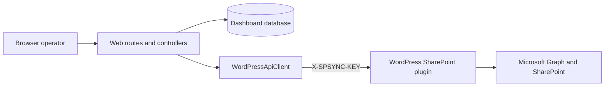

# Software Requirements Specification — Central Backup Dashboard

Document version: 1.0  
Review date: 11 November 2026  
Scope: `dashboard/`  
Basis: source inspection of controllers, service, models, migrations, routes, Blade views, dependency manifests, configuration, deployment files, and existing tests.

## 1. Purpose and interpretation

This application is the central browser interface for managing WordPress installations running the SharePoint backup plugin in `../plugin/`. It registers sites, sends remote commands, stores local summaries, and presents backup, restore, connection, and migration information.

This is a reverse-engineered SRS describing the supplied implementation. Requirements marked **Implemented** have a source implementation, not a guarantee of successful production execution. **Partial** means the implementation has a material limitation. **Required gap** describes a requirement that should be resolved before relying on the corresponding capability. Acceptance scenarios below are verification criteria, not claims that those scenarios were executed.

The dashboard does not create archives, authenticate directly to Microsoft Graph, or restore files itself. Those operations execute inside WordPress. No direct integration with the Python SEO backend was found in the reviewed application routes and service.

## 2. Users and operating context

- **Fleet operator:** registers WordPress sites, tests connectivity, triggers backups, reviews histories, and requests restores.
- **Migration operator:** labels a site as a migration target and performs database URL replacement after restoration.
- **Deployment administrator:** configures the Laravel application, database, network access, and access protection.

These are operational roles. The application does not currently enforce separate permissions for them.

### Technology baseline

| Component | Source-backed baseline |
|---|---|
| PHP | `^8.3` in `composer.json` |
| Laravel | `^13.17`; `composer.lock` resolves framework `v13.29.0` |
| Presentation | Blade templates, JavaScript, shared Tailwind CDN layout |
| Asset tooling | Vite `^8.0.0`, Tailwind `^4.0.0`, Laravel Vite plugin `^3.1` |
| Persistence | Eloquent; SQLite default, other configured Laravel database drivers possible |
| Remote interface | WordPress REST API, namespace `spsync/v1`, shared API key |
| Container setup | Node asset stage; FrankenPHP/PHP 8.3 runtime; Compose binds localhost port 8000 |

The root README's Laravel 11 description is stale relative to the manifests. The active shared application layout loads Tailwind from a CDN; the existence of Vite tooling does not mean these screens depend exclusively on built assets.

## 3. Structure and responsibilities

| Path | Responsibility |
|---|---|
| `public/index.php`, `bootstrap/app.php` | Laravel entry and routing; framework health route `/up` |
| `routes/web.php` | Dashboard, site CRUD, diagnostics, commands, status polling |
| `app/Http/Controllers/DashboardController.php` | Fleet metrics and recent histories |
| `app/Http/Controllers/WebsiteController.php` | Validation, site management, operator actions, redirect/JSON responses |
| `app/Services/WordPressApiClient.php` | Shared-key HTTP transport and synchronization into local models |
| `app/Models/Website.php` | Registered site, purpose, cached status, relationships |
| `app/Models/BackupLog.php` | Local backup summary and remote-missing flag |
| `app/Models/RestoreLog.php` | Local restore summary and elapsed-time formatting |
| `app/Models/ActivityLog.php` | Operator activity, severity, JSON context |
| `app/Models/User.php` | Framework user entity; no application login routes currently wired |
| `database/migrations/` | Framework tables plus websites and three history tables |
| `database/seeders/DatabaseSeeder.php` | Demonstration sites and histories; not a production inventory |
| `resources/views/dashboard.blade.php` | Fleet overview and command controls |
| `resources/views/websites/` | List, create, edit, detail, migration and restore controls |
| `resources/views/layouts/app.blade.php` | Shared navigation, styles, fonts, script stack |
| `routes/console.php` | Example inspiration command; no fleet synchronization schedule |
| `tests/` | Framework example tests; no substantive remote-workflow coverage |

### Dependency direction

SharePoint credentials belong to the plugin. The dashboard stores the plugin API key for each site. Its local histories are a cache of observed events and status, not the authoritative backup artifacts.

## 4. Functional requirements

| ID | Requirement and observable behavior | Status / implementation |
|---|---|---|
| D-FR-01 | Register a site with name, URL and API key; accept optional purpose `backup` or `migration`, defaulting to `backup`; remove trailing URL slash. | Implemented — `WebsiteController::store` |
| D-FR-02 | Validate name/key as required strings up to 255 characters and URL using Laravel URL validation. | Implemented — `store`, `update` |
| D-FR-03 | On registration, attempt health and system-information requests, save site even when remote connectivity fails, and log registration. | Implemented — `store`, API client |
| D-FR-04 | List sites alphabetically, search name/URL, filter status, and paginate 15 per page while retaining filters. | Implemented — `index` |
| D-FR-05 | Edit site identity, purpose, URL and key; delete a site and cascade its related histories. | Implemented — controller and migration foreign keys |
| D-FR-06 | Show total/online sites, completed non-missing backups, missing backups, active jobs, restore totals and successful restores. | Implemented with status caveats — `DashboardController::index` |
| D-FR-07 | Show ten recent activities and eight recent backups and restores on the overview. | Implemented — dashboard controller |
| D-FR-08 | Test WordPress health, cache diagnostics, and report network versus HTTP errors. | Implemented — `checkHealth`, `getSystemInfo` |
| D-FR-09 | Ask WordPress to test SharePoint and record connection status and activity. | Implemented — `testSharePointConnection` |
| D-FR-10 | Run combined WordPress, diagnostics, SharePoint and remote verification checks; stop combined checks if health fails. | Implemented — `testAllConnections` |
| D-FR-11 | Trigger one backup, create a queued local backup log and activity after an accepted remote response. | Partial — asynchronous plugin job ID can differ from returned ID |
| D-FR-12 | Trigger backups for a nonempty array of existing site IDs and report individual failures and aggregate counts. | Implemented sequentially — `bulkTriggerBackup` |
| D-FR-13 | Poll the latest remote backup, upsert its counters/status, and update an existing active restore record when its job ID matches. | Partial — latest-job-only synchronization |
| D-FR-14 | Display per-site backup and restore histories with separate ten-row pagination. | Implemented — `show` |
| D-FR-15 | Discover remote backup identifiers and mark known absent backups as missing using the plugin response. | Partial — folder-presence verification, not artifact integrity |
| D-FR-16 | Request restoration by backup ID, save returned job ID, set local start time and track elapsed time on later polls. | Partial — plugin preparation runs before response; timing excludes that preparation |
| D-FR-17 | Validate old/new URLs, support dry run, request serialized-aware search/replace, and display returned summary. | Implemented orchestration — actual mutation belongs to plugin |
| D-FR-18 | Present confirmation controls for backup, restore, deletion, bulk backup and live URL replacement where provided by views. | Implemented UI controls; not a server authorization boundary |
| D-FR-19 | Fetch up to a requested number of remote execution logs through the service. | Service implemented — `fetchLogs`; no dedicated application route exposes it |

Purpose currently changes labeling and migration guidance. It is not a server-side restriction preventing a migration-target site from receiving a backup command.

## 5. Workflows and failure behavior

### Site registration and diagnostics

1. Browser submits validated registration.
2. A `Website` record is persisted.
3. Health request sets `online` on successful HTTP response, `error` on non-success HTTP, or `offline` on exception.
4. Diagnostics may cache WordPress/PHP versions, memory/upload settings, database size, SharePoint folder and disk capacity.
5. Operator is redirected to details with an activity entry.

An HTTP-successful health response is sufficient for the dashboard's online classification; the client's health method does not reject a response whose database field reports missing plugin tables.

### Backup and status synchronization

1. A POST reaches the plugin's `/backup/start`.
2. The dashboard records the returned identifier as `queued`.
3. The plugin creates artifacts and uploads independently.
4. A browser request to `/websites/{website}/poll-status` fetches the latest remote job.
5. Local `BackupLog` is created or updated using `(website_id, backup_id)`.

The details page starts a five-second polling interval and prevents overlapping browser polls. Its current JavaScript only updates the displayed last-sync text; it does not rebuild the backup/restore history tables from the returned JSON. The fleet overview has no equivalent automatic fleet polling loop. There is no scheduled server-side fleet sync in `routes/console.php`.

### Remote verification

The client merges `verified_backups` and `remote_backups`, upserts them as completed/non-missing with `verified_at`, and flags identifiers listed in `missing_backups`. Consequently a folder discovered by the plugin can be shown as completed without proof that its manifest and all parts exist.

### Restore

The dashboard POSTs `backup_id` to `/restore/start`, creates a `RestoreLog` initially marked `downloading`, and later records completion/failure timestamps when a matching restore status is returned. The plugin performs the rollback snapshot and manifest download before returning acceptance. A 15-second dashboard timeout can therefore expire while WordPress is still preparing or starting a restore.

### URL migration

The dashboard passes `old_url`, `new_url` and string `true`/`false` dry-run values to the plugin, logs the result and flashes the per-table summary. It does not change its own registered `Website.url` afterward. Operators must keep the dashboard URL aligned with the site's final reachable address.

## 6. Interfaces

### Browser routes

| Method | Path | Purpose |
|---|---|---|
| GET | `/` | Fleet overview |
| GET / POST | `/websites` | List / register |
| GET | `/websites/create` | Registration form |
| GET / PUT / DELETE | `/websites/{website}` | Details / update / remove |
| GET | `/websites/{website}/edit` | Edit form |
| POST | `/websites/{website}/test-wp`, `/test-sharepoint`, `/test-all` | Diagnostics; suffixes relative to site route |
| POST | `/websites/{website}/verify-backups` | Remote verification |
| POST | `/websites/{website}/trigger-backup`, `/trigger-restore`, `/update-url` | Operator commands |
| GET | `/websites/{website}/poll-status` | JSON snapshot and remote synchronization |
| POST | `/websites/bulk-trigger-backup` | Batch backup command |
| GET | `/up` | Framework health route |

### Outbound WordPress contract

All paths below follow `{site_url}/wp-json/spsync/v1/`. Requests use `X-SPSYNC-KEY` and `Accept: application/json`.

| Method | Endpoint | Timeout | Important data |
|---|---|---|---|
| GET | `health` | 10 s | HTTP success drives online state |
| GET | `system/info` | 15 s | Cached diagnostic JSON |
| POST | `connection/test` | 30 s | Requires HTTP success and truthy `success` |
| POST | `backup/start` | 15 s | `backup_id` |
| GET | `backup/status` | 10 s | Latest ID/status/file counters; nested `restore` |
| POST | `restore/start` | 15 s | Request `backup_id`; response `restore_job_id` |
| GET | `backups/verify` | 30 s | Verified, missing and remote identifier arrays |
| GET | `logs?limit=N` | 10 s | Remote execution logs |
| POST | `database/search-replace` | 60 s | Old/new URLs, dry run, replacement counts |

All outbound requests currently call `withoutVerifying()`, disabling TLS certificate validation.

## 7. Data requirements

| Entity | Main data | Relationships / lifecycle |
|---|---|---|
| `websites` | name, purpose, URL, API key, site status, SharePoint status, diagnostics JSON, sync/backup times | Parent of all three history entities |
| `backup_logs` | remote backup ID, status, total/uploaded files, optional size, removed flag, verification time | Indexed by site/backup ID; index is not unique |
| `restore_logs` | backup/job IDs, status, start/completion times, duration, error text | Indexed by site/job ID; error field exists but polling does not populate remote error details |
| `activity_logs` | optional site ID, action, severity, message, JSON context | Site deletion cascades site-related entries; bulk activity may have no site |
| Framework tables | users, password resets, sessions, jobs, failed jobs, cache and locks | Generic Laravel infrastructure |

Declared backup states include `queued`, `uploading`, `completed`, `failed`, `missing`. Restore states include `pending`, `downloading`, `extracting`, `restoring_database`, `completed`, `failed`; the plugin additionally emits `cleanup`. Statuses are strings rather than database enums.

`last_backup_at` is set to dashboard `now()` whenever a completed remote job is polled, so it does not reliably represent the original backup creation/completion time. Duration displays are dashboard-observed estimates. The service does not populate every declared model field, including backup file size.

## 8. Nonfunctional requirements and gaps

| ID | Requirement | Current assessment |
|---|---|---|
| D-NFR-01 | Restrict all management and destructive actions to authenticated authorized operators. | Required gap: no `auth` middleware or application login flow on management routes |
| D-NFR-02 | Protect remote credentials at rest and in presentation. | Required gap: website API key is a normal string column without encrypted/hidden model casts |
| D-NFR-03 | Verify remote server certificates. | Required gap: client disables TLS verification globally |
| D-NFR-04 | Validate site targets against the deployment's allowed destinations. | Required gap: general URL validation does not prevent requests to internal network targets |
| D-NFR-05 | Keep per-site statistics isolated. | Required gap: `show()` missing-count query has an ungrouped `orWhere('status', 'missing')`, potentially counting other sites |
| D-NFR-06 | Report remote polling failures honestly. | Required gap: controller returns `success: true` even when service synchronization fails |
| D-NFR-07 | Use one durable job identity from acceptance to completion. | Required gap: plugin creates a new timestamp ID during deferred execution |
| D-NFR-08 | Handle large fleets without request-duration growth proportional to all sites. | Partial: bulk commands run sequentially in the request; no application jobs are dispatched |
| D-NFR-09 | Count all active restore phases consistently. | Partial: overview active-job count omits plugin `cleanup` phase |
| D-NFR-10 | Provide repeatable application and integration tests. | Required gap: only example tests exist; no mocked API-contract or workflow suite |

No measured availability, maximum supported site count, recovery-time objective, recovery-point objective, or response-time SLA is established by this code. README claims of unlimited fleet size are not verified capacity specifications.

## 9. Deployment constraints

- Configure a Laravel application key and a persistent database; run migrations for both domain and framework tables.
- Production data must not be inferred from the demo seeder.
- Maintain outbound reachability to each paired WordPress REST endpoint. The dashboard itself does not require Microsoft Graph secrets.
- Compose uses persistent volumes for SQLite and storage, but the SQLite path must agree with environment configuration. The Dockerfile creates `/app-db/database.sqlite`; it does not generate an application key or run database migrations.
- The active layout also depends on external Tailwind and Google Fonts resources.
- A complete Composer installation is required. The supplied local `vendor/` contains some tools but lacks `vendor/autoload.php` at review time.

## 10. Acceptance scenarios

| ID | Scenario / expected result | Related requirements |
|---|---|---|
| D-AC-01 | Register reachable and unreachable sites; both persist, with appropriate connection result and an activity entry. | D-FR-01–03, 08 |
| D-AC-02 | Search/filter more than 15 sites; paging retains filters and stable alphabetical ordering. | D-FR-04 |
| D-AC-03 | Trigger selected sites with mixed remote success/failure; aggregate counts and failed-site names match responses. | D-FR-11–12 |
| D-AC-04 | Poll queued, uploading, completed and failed remote jobs; exactly one logical log per remote job should remain. | D-FR-13, D-NFR-07 |
| D-AC-05 | Remove a remote folder and verify; only the correct site's known backup is marked missing. | D-FR-15, D-NFR-05 |
| D-AC-06 | Restore through every plugin phase including cleanup; terminal status and elapsed time become visible. | D-FR-16, D-NFR-09 |
| D-AC-07 | Dry-run then live URL replacement; dry run leaves site data unchanged and live result is recorded. | D-FR-17 |
| D-AC-08 | Attempt management actions without login and against disallowed URLs; reject them once access gaps are addressed. | D-NFR-01, 04 |

## 11. Review validation and unresolved decisions

PHP 8.3.30 and Composer 2.9.4 were located in Laragon, although neither was initially on PATH. A combined syntax pass across plugin PHP and dashboard application/configuration/migration/test PHP checked 60 files with no syntax errors. Running the existing dashboard PHPUnit command stopped before tests because `vendor/autoload.php` is missing. No live WordPress, SharePoint, restore or URL-migration requests were made. Application code, dependencies and configuration were not changed for this review.

Decisions still needed: intended login/permission model; permitted site destinations; authoritative job identity contract; background synchronization expectations; handling of shared SharePoint folders across sites; and required recovery/availability targets.
