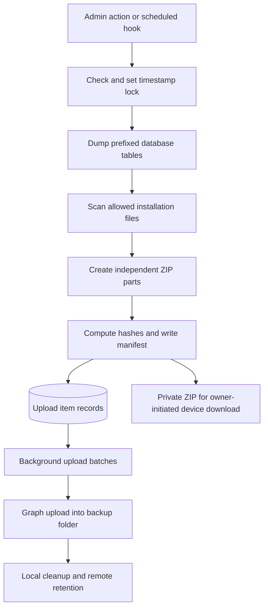

# Software Requirements Specification — WordPress SharePoint Backup Plugin

Document version: 1.3.0
Review date: 11 November 2026  
Scope: `plugin/` source; packaged ZIP assessed separately  
Basis: the original source plus the 1.1.0 selection/restoration and 1.2.0 manual-device/automatic-cloud workflows and regression harness. This document includes the implementation changes made on 11 November 2026.

## 1. Purpose and status conventions

The plugin creates WordPress database/file backups, uploads them to SharePoint through Microsoft Graph, schedules recurring work, exposes remote management endpoints, restores backups and performs database URL migration.

This SRS is derived from source. **Implemented** means an implementation exists; **Partial** means its limitations materially affect the requirement; **Required gap** identifies behavior needed for reliable operation but not established by the supplied implementation. Acceptance scenarios are proposed checks, not executed production tests.

The Laravel dashboard in `../dashboard/` and the Python SEO backend are remote backup clients. For SEO publishing, the Python backend uses a different connector (`seo-agentic-connector`); this plugin does not implement that connector's `sac` APIs, article publishing, Yoast synchronization or reverse-push protocol.

## 2. Runtime and actors

| Item | Declared or observed requirement |
|---|---|
| Plugin identity | WordPress SharePoint Backup Plugin; `SPSYNC_VERSION` 1.3.0 |
| Declared compatibility | PHP 7.4+, WordPress 6.0+ in entry header; not fully compatibility-tested |
| Database | WordPress `$wpdb` with MySQL-style SQL |
| Archive support | ZipArchive preferred; WordPress PclZip fallback |
| Scheduling | Action Scheduler if present; WP-Cron fallback; Action Scheduler is not bundled here |
| Filesystem | Read WordPress installation; write uploads backup/restore directories; overwrite installation during restore |
| Network | Microsoft identity token endpoint and Microsoft Graph v1.0; signed Graph download/upload URLs |
| Administration | WordPress user with `manage_options` |
| Remote management | Client possessing `X-SPSYNC-KEY` |

Microsoft application permissions and tenant consent must be provisioned externally. The source requests Graph's `.default` scope; it does not grant permissions or prove the tenant's actual authorization configuration.

## 3. Code structure

| Path | Responsibility |
|---|---|
| `schedule-backup-plugin.php` | Metadata, constants, namespace autoloading, activation and component hooks |
| `admin/SettingsPage.php` | Seven-tab UI, manual/automatic method selection, device downloads, backup contents, upload/review/restore and diagnostics |
| `api/RestController.php` | Shared-key authentication and nine remote endpoints |
| `database/Installer.php` | Four custom tables and initial settings/API key |
| `database/DatabaseMigrator.php` | URL matching, recursive serialization-aware replacement and cache flushing |
| `helpers/Settings.php`, `Encryption.php` | Custom settings persistence; client-secret encryption/decryption |
| `helpers/PrivateStorage.php` | Validate/create/remove private import and device-download temporary directories |
| `logger/Logger.php` | Structured database logs and daily 30-day cleanup |
| `auth/OAuth.php` | Client-credentials token acquisition and transient caching |
| `auth/GraphClient.php` | Graph requests and cached site/drive/root-folder discovery |
| `backup/BackupEngine.php` | Local backup orchestration and upload queue creation |
| `backup/DatabaseBackup.php` | SQL dump of prefix-matching tables |
| `backup/FileScanner.php` | Installation traversal and exclusions |
| `backup/BackupSelection.php` | Discover wp-content directories, validate/persist selected scope and optional database inclusion |
| `backup/DeviceBackup.php` | Background private backup creation, owner-bound download jobs, ZIP packaging, cancellation and expiry |
| `backup/ZipBuilder.php` | Independent ZIP parts grouped by input size |
| `backup/Retention.php` | Oldest matching remote folder pruning |
| `queue/QueueManager.php` | Background batches and upload completion cleanup |
| `storage/SharePointStorage.php` | Remote backup folders, small uploads and chunk sessions |
| `scheduler/Scheduler.php` | Calendar start-time calculation and cron event setup |
| `restore/RestoreManager.php` | Restore queue and phase transitions |
| `restore/DownloadManager.php` | Stream remote files to disk and check expected SHA-256 |
| `restore/RestoreEngine.php` | ZIP extraction, batched SQL execution and rollback snapshot |
| `restore/LocalBackup.php` | Private ZIP/folder/file staging, safe outer-package extraction, manifest/part verification and cleanup |
| `restore/ManualRestore.php` | Immediate after-response restoration, durable scheduled fallback, destination snapshot and rollback |
| `tests/run.php` | Isolated regression harness using temporary sites and WordPress/database stubs |
| `README.md` | Installation, backup-selection and manual-restoration instructions |
| `schedule_backup_plugin.zip` | Rebuilt 1.3.0 installable package; includes application PHP and README, excludes tests/SRS |

### Bootstrap detail that affects deployment

Namespaces use capitalized components (`SPSync\Database`, `SPSync\Api`, etc.), while directories are lowercase (`database`, `api`, etc.). Version 1.1.0 maps namespace directories to lowercase while retaining class filename casing, fixing the original case-sensitive-filesystem loading defect.

## 4. Functional requirements

| ID | Requirement / observable behavior | Status and source |
|---|---|---|
| P-FR-01 | On activation, create/upgrade settings, logs, upload-items and restore-items tables without replacing existing settings. | Implemented — `Installer::activate` |
| P-FR-02 | Generate a random API key and seed manual schedule, root folder, encryption flag and 30-backup retention. | Implemented — installer |
| P-FR-03 | Restrict WordPress admin actions to `manage_options` and validate nonces. | Implemented — settings page |
| P-FR-04 | Save Microsoft credentials, library/folder selection, schedule options and retention; allow API-key regeneration. | Implemented with encryption-toggle caveat |
| P-FR-05 | Retrieve a Microsoft client-credentials token, cache it with an expiry buffer, resolve SharePoint site/drive/folder, and create missing root folder. | Implemented — OAuth/Graph client |
| P-FR-06 | Export table structure/data for tables matching the active WordPress prefix using 500-row fetch batches. | Implemented — database backup; no transaction snapshot guarantee |
| P-FR-07 | Scan the WordPress installation, excluding backup/cache/temp/log directories and archive/log/temp extensions. | Implemented — file scanner |
| P-FR-08 | Build independent ZIP parts from groups targeting 52,428,800 input bytes, with ZipArchive or PclZip. | Implemented — zip builder; individual oversized files are not split |
| P-FR-09 | Produce the selected SQL/ZIP components and a manifest with selection metadata, per-part sizes and SHA-256 hashes; enqueue every component including manifest. | Implemented — backup engine; full website/database remains default |
| P-FR-10 | Prevent ordinary overlapping backups using a timestamp lock, considering locks older than ten minutes stale. | Partial — non-atomic lock; normal admin backup no longer forcibly overrides it; explicit reset action remains |
| P-FR-11 | Process upload batches, default five files, using Action Scheduler or WP-Cron. | Implemented — queue manager |
| P-FR-12 | Upload files below 4 MiB directly; use 3,276,800-byte chunks for larger files. | Implemented — storage |
| P-FR-13 | Retry chunk network/throttle failures and retry whole-file attempts, marking permanent failure. | Partial — some early errors bypass retries |
| P-FR-14 | Remove local backup files after successful queue completion and enforce retention. | Partial — final-batch bookkeeping does not establish all-job success |
| P-FR-15 | Schedule manual, daily, weekly, monthly and one-time backups at a selected WordPress-local start time. | Partial — monthly recurrence is fixed 30-day interval |
| P-FR-16 | Expose health, diagnostics, latest backup status, logs and remote connection test behind shared-key authentication. | Implemented — REST controller |
| P-FR-17 | Discover remote backup folders and mark known absent backup IDs missing. | Partial — complete paginated listing is required before mutation; folder presence is not a completeness/hash check |
| P-FR-18 | Before restore, create local rollback SQL and selected-file snapshot, download manifest and enqueue manifest parts. | Implemented preparation, with coverage/concurrency limitations |
| P-FR-19 | Stream downloads, check supplied SHA-256, retry downloads, validate/extract ZIP parts and import SQL in resumable batches. | Implemented with legacy parser limitations — failures propagate and plugin control tables are preserved |
| P-FR-20 | On restore failure, attempt rollback and expose failed state. | Partial — rollback now completes SQL batches; remote rollback file coverage remains limited |
| P-FR-21 | Perform dry-run/live URL replacement across prefix-matching text-like columns while preserving recognized PHP serialized data. | Implemented with query/error/security limitations |
| P-FR-22 | Keep execution logs with severity/context and prune entries older than 30 days daily. | Implemented — logger |
| P-FR-23 | Preserve custom data on deactivation. | Implemented — empty deactivation hook; no uninstall implementation supplied |
| P-FR-24 | Offer a Backup Contents tab with entire website/database selected by default; allow plugins, themes, uploads and other discovered wp-content directories. | Implemented — selection class, scanner and admin tab |
| P-FR-25 | Allow an optional database in selected mode, including database-only backups; reject empty/invalid selections and apply saved scope to every backup entry point. | Implemented — selection validation and shared backup engine |
| P-FR-26 | Accept one plugin backup ZIP, folder or set of component files without SharePoint credentials; stage privately and verify layout, manifest, lengths, hashes and archive paths before restoration. | Implemented — LocalBackup and Manual Restore tab |
| P-FR-27 | Require an administrator nonce and upfront overwrite confirmation; after successful upload verification, immediately dispatch restoration without a second Start action and display status/errors. | Implemented — response-shutdown dispatch with scheduled fallback |
| P-FR-28 | Snapshot the actual overwritten local-restore files and optional database; on handled failure restore the snapshot, remove newly introduced files and retain recovery artifacts. | Implemented best-effort recovery; interrupted/killed processes can require administrator intervention |
| P-FR-29 | Let administrators select manual-device or automatic-SharePoint operation; manual selection clears the automatic schedule, while upgrades preserve existing schedules. | Implemented — method is represented by saved backup frequency; credentials and schedule save independently |
| P-FR-30 | Prepare a device backup in the background without cloud credentials, using the saved full/selected/database-only scope and without SharePoint queue insertion. | Implemented — DeviceBackup and device branch of BackupEngine |
| P-FR-31 | Provide an administrator-capability/nonce/ownership-checked ZIP attachment containing the manifest and all selected components; require a user download action. | Implemented — authenticated streaming download; browser controls final save location |
| P-FR-32 | Expire download access after 24 hours, schedule private-copy deletion and allow owner cancellation/removal; preserve downloaded device files. | Implemented — cron cleanup can be delayed when cron is not running |

## 5. Backup operation in detail

### Artifact contract

- Backup ID: `spsync-backup-YYYYMMDD-HHMMSS`, generated using WordPress local time.
- Local directory: `{uploads_basedir}/spsync-backups/{backup_id}/`.
- Files: `database.sql`, `backup_part001.zip` and following parts, `manifest.json`.
- Manifest: `backup_id`, UTC timestamp, WordPress/PHP/plugin versions, `backup_type: full`, `parts` array.
- Each part describes `filename`, `filesize`, `checksum`. The manifest itself is queued and hashed locally but is not included in its own parts array.
- Remote path: selected library → configured root folder → backup ID folder → artifacts.

Despite the `full` label, excluded file types/directories are not backed up. Full mode retains the original exclusions: directories named `.git`, `node_modules`, `cache`, `logs`, `tmp`, `spsync-backups` and extensions `log`, `tmp`, `zip`, `gz`, `tar`. Explicit-directory mode includes regular files and archive extensions inside those chosen directories, excluding backup storage and symlinks. SQL export still includes plugin control tables; the restore importer skips their generated DROP/CREATE/INSERT statements to preserve the active restore state.

Manifests record `backup_type` as `full` or `selected` and include `selection` with mode, directory names and database inclusion. SQL is omitted when not selected; database-only backups contain SQL and a manifest without ZIP parts. Archives continue using installation-relative paths. Source directories outside the installation and symlinked directories are unsupported by the scanner.

ZIP parts are separate archives, not byte segments of one multi-volume ZIP. The split threshold measures uncompressed input sizes; it is not a hard compressed-output size limit. Backup creation is synchronous within the worker/admin request and builds the file list in memory.

### Upload states and retries

Item states are `queued`, `uploading`, `done`, `error`, and later `missing`. Workers select queued/uploading rows with retries below three. Normal failed uploads requeue until the third attempt. Missing local files or failure resolving the destination folder immediately set `error`.

Chunk requests allow three attempts for network failures or throttling. Network waits are `retries * 2` seconds, a linear sequence rather than the exponential backoff described in a comment. Throttling uses `Retry-After` where available. Other chunk HTTP failures terminate that session. Whole-file retries create a new session; byte offsets and upload sessions are not persisted across workers.

The queue is global across backups. Final cleanup uses the first item of the last batch and the current batch's failure flag. It does not independently verify success of every item in every backup before deleting local files or enforcing retention.

## 6. Restore and migration operation

### Restore phases

`downloading → extracting → restoring_database → cleanup → completed`; failure paths attempt rollback and set `failed`.

1. `start_restore()` creates rollback artifacts synchronously before retrieving the remote manifest.
2. It sets active job/backup/status settings and truncates the shared restore queue.
3. Each download worker processes one part, finds its expected hash in the manifest and retries up to three times.
4. Extraction writes ZIP content directly into `ABSPATH`.
5. SQL import parses semicolon-terminated lines and checkpoints after 500 statements using `restore_db_offset`.
6. Cleanup removes downloaded and rollback artifacts, then records completion.

Rollback SQL covers prefix-matching tables. Rollback files cover themes, plugins, `wp-config.php` and `.htaccess`; they do not cover the full core installation or uploaded media. ZIP extraction overwrites files but does not remove all files created after the backup.

### Material restore limitations

- No restore/backup mutual exclusion or restore-specific atomic lock is present. A second restore can truncate the first job's queue and overwrite shared paths/settings.
- SQL restore reports missing/unreadable files, incomplete trailing statements and failed queries as errors. Generated statements targeting plugin control tables are skipped; new jobs reset the global SQL offset.
- Rollback drives every SQL batch to completion. Remote rollback still has the limited file coverage described above; local rollback snapshots the actual destination files instead.
- Remote manifest filenames are still used to build local paths without the strict filename restrictions used for local uploads. ZIP-entry traversal, absolute paths, special files and existing destination symlinks are now validated before extraction.
- The manifest is downloaded without an independent trusted expected hash/signature. Part hashes detect mismatch against that manifest, not malicious replacement of both.
- Restore information is now returned by the status endpoint even without prior backup queue records.

### URL migration

`DatabaseMigrator::search_and_replace()` trims URLs, rejects missing/equal values, scans prefix-matching tables, excludes the four plugin control tables, identifies text-like columns and locates matching rows. It recursively replaces strings inside recognized serialized strings, arrays and object properties, then serializes values again. A primary-key column is used where available; otherwise the original row is the match condition.

Dry run computes counts and writes execution logs but skips target-row changes. Live mode also sets `siteurl` and `home` to the new URL regardless of whether the old URL matched them, then flushes rewrite rules/cache. Reported counts track intended changed rows rather than confirmed successful SQL writes.

The candidate-row `LIKE` condition is assembled with `esc_like()` but not a prepared value; SQL quoting and hostile input handling require correction. `unserialize()` is used without restricting allowed object classes. Full candidate result sets are loaded into memory.

## 7. REST interface specification

Base: `{wordpress_url}/wp-json/spsync/v1/`.

Authentication: all nine routes use `check_auth()`. Missing configured key returns 403. Missing/wrong incoming key returns 401. Valid key is compared with `hash_equals()`. It grants the complete remote command set; there are no scoped API permissions.

| Method | Endpoint | Input and response |
|---|---|---|
| GET | `health` | Plugin identity/version/database status/timestamp; HTTP 200 even when diagnostic database state is `missing_tables` |
| POST | `connection/test` | Refresh token and rediscover cloud IDs; 200 success or 400 failure |
| GET | `system/info` | Versions, limits, DB size, SharePoint folder and disk data |
| GET | `backup/status` | Latest job aggregate, phase, progress and counters; restore job/status when a backup exists |
| POST | `backup/start` | Enqueue scheduled-backup hook; return 202 with generated backup ID |
| POST | `restore/start` | Require `backup_id`; prepare restore, return 202/job ID or error |
| GET | `logs` | Default limit 50, maximum 100, newest-first |
| GET | `backups/verify` | Verified/missing/remote identifier arrays and remote count |
| POST | `database/search-replace` | Require `old_url`, `new_url`; boolean-like `dry_run`; return table/row/replacement counts and duration |

As of 1.2.1, the ID returned by `backup/start` is reserved in a WordPress option and passed through the scheduled hook into `BackupEngine::run()`. Polling returns that queued ID before packaging and reports identifiable failures that occur before upload queue insertion. Duplicate queued API starts are rejected, scheduler failures are returned honestly, and explicit API requests do not reset an independent one-time automatic schedule.

Remote verification now follows Graph listing pages and returns an error before changing statuses when the listing fails, is incomplete, or supplies an untrusted pagination URL. It still accepts returned folders with loose file-name handling and does not inspect manifest/part validity. Already-missing item rows are not restored to `done` when a folder reappears.

## 8. Data and configuration

| Table (WordPress prefix prepended) | Required data |
|---|---|
| `spsync_settings` | Key/value text settings; primary key `option_name`; credentials, cloud IDs, schedule, active locks/jobs/offsets |
| `spsync_logs` | ID, level, message, JSON context, UTC created time |
| `spsync_items` | Backup ID, filename, size, status, retries, SHA-256, UTC created time |
| `spsync_restore_items` | Restore job ID, filename, state, retries, downloaded/restored flags, UTC created time |

Cloud site/drive/root IDs persist in settings. OAuth token uses a transient, cached for `max(60, expires_in - 300)` seconds. Individual remote backup-folder IDs use one-hour transients. Connection testing clears persistent discovery IDs before rediscovery.

Client-secret encryption uses AES-256-CBC, random IV and a key derived from WordPress salts. The no-OpenSSL fallback is base64 encoding, which is not encryption. API keys are stored as plain settings values. The 1.2.0 credential handler reads the current secret before changing the encryption flag and then stores it under the selected mode, avoiding the original flag-change ordering defect.

## 9. Scheduling and retention

- Daily uses WordPress's daily interval; weekly uses seven days.
- Monthly calculates an initial selected day clamped to 1–28, then repeats every 30 days. This can drift from the selected calendar date.
- One-time invalid/past date falls back to one hour from now rather than rejecting it.
- After the scheduled hook, `once` is reset to manual even if backup generation fails.
- Normal admin backup respects the running-job lock; the explicit reset-lock action remains available for stale locks.
- Deactivation does not clear backup/upload/restore/log cleanup hooks.
- Retention defaults to 30; a nonpositive limit skips pruning. Matching `spsync-backup-` folders are sorted by name, oldest first. Only one listing page is inspected.
- Retention deletes corresponding queue rows without checking whether the remote DELETE succeeded, potentially losing local tracking for a still-present backup.

WP-Cron timing depends on an external cron driver or site traffic. No exact execution-time guarantee is established. Multiple sites using the same cloud root can affect each other's discovered backups and retention because the folder hierarchy has no enforced site-identity level.

## 10. Nonfunctional requirements

| ID | Requirement | Assessment |
|---|---|---|
| P-NFR-01 | Load correctly on supported Windows and case-sensitive Linux installations. | Namespace/directory mapping fixed; a full Linux/WordPress integration check remains pending |
| P-NFR-02 | Authenticate all remote destructive operations and authorize admin forms. | Implemented key/capability/nonce checks; key rotation and scoped access need operating policy |
| P-NFR-03 | Ensure TLS verification for cloud calls. | Implemented on normal token, Graph, upload and download requests |
| P-NFR-04 | Protect local backup, restore and rollback artifacts from web access. | Partial — backup directories get Apache denial/index files; equivalent protection for all shared restore/rollback paths and other servers is not established |
| P-NFR-05 | Preserve recoverable job state across process failures and self-restoration. | Partial — control-table import is skipped; local worker keeps loaded code during self-restoration; hard process loss can still require manual recovery |
| P-NFR-06 | Do not report restore/rollback success after SQL or file failure. | Improved — SQL errors propagate and rollback finishes batches; recovery remains best-effort |
| P-NFR-07 | Verify every backup component before retention/local deletion. | Required gap — current completion and verification logic are insufficient |
| P-NFR-08 | Constrain all filesystem writes/extraction to intended destinations. | Local upload filenames/private staging and ZIP entries validated; remote manifest filename handling remains a gap |
| P-NFR-09 | Enforce retention over the complete remote inventory and only after confirmed deletion. | Required gap — pagination and delete-result handling |
| P-NFR-10 | Bound memory and work on large sites. | Partial — row/chunk batching exists, but scanning, migration and some archive work hold full collections |
| P-NFR-11 | Provide repeatable backup/restore integration tests. | 132 isolated checks, 11 HTTP upload/restore cases and a PclZip fallback check passed; live WordPress/SharePoint integration remains pending |

No backup encryption-at-rest feature for SQL/ZIP artifacts, incremental backups, verified point-in-time database consistency, multisite-wide orchestration, or measured RTO/RPO is implemented or established by the inspected source.

## 11. Acceptance scenarios and validation status

| ID | Expected verification | Related requirements |
|---|---|---|
| P-AC-01 | Activate on a clean and already-configured site; tables/key/defaults are created idempotently and existing credentials survive. | P-FR-01–02 |
| P-AC-02 | Load on a case-sensitive Linux host and exercise every autoloaded component. | P-NFR-01 |
| P-AC-03 | Reject unauthorized REST/admin actions; accept correctly authenticated calls. | P-FR-03, 16 |
| P-AC-04 | Back up fixture data with serialized values, NULLs, binary/text content and large tables; compare restored data and file hashes. | P-FR-06–09, 19 |
| P-AC-05 | Exercise files below/above 4 MiB, oversized individual files, network failures, 429s and interrupted uploads. | P-FR-08, 12–13 |
| P-AC-06 | Fail an early upload batch and succeed a later batch; no incomplete backup should lose local recovery artifacts. | P-FR-14, P-NFR-07 |
| P-AC-07 | Verify absent, reappearing, incomplete and paginated backups without turning listing failures into missing-backup claims. | P-FR-17, P-NFR-09 |
| P-AC-08 | Restore on a fresh target and through all phases; plugin state remains usable while its own tables/files are restored. | P-FR-18–20, P-NFR-05 |
| P-AC-09 | Inject SQL errors and rollback dumps exceeding 500 statements; terminal result must reflect complete recovery or failure. | P-NFR-06 |
| P-AC-10 | Dry-run/live migration on nested serialized values, quoted URLs and tables without simple primary keys. | P-FR-21 |
| P-AC-11 | Test calendar recurrence, one-time failure, deactivation and multiple sites sharing cloud roots. | P-FR-15, P-NFR-09 |

The initial review checked the original 21 plugin PHP files as part of a 60-file syntax pass and confirmed original ZIP/source parity. For 1.1.0, all plugin PHP is checked again and the installable package is rebuilt from current application sources. The new isolated harness passes 65 checks, including selected/full/database-only backups, manual file/database restoration, rollback after an SQL failure, unsafe/corrupt/missing artifacts, UI rendering and permission/confirmation gates. A temporary localhost PHP server also accepted a real multipart upload and rejected corrupt/missing parts in three cases.

These tests use temporary fixtures and WordPress/database stubs. No production site or SharePoint tenant was modified, and live WordPress restoration, remote retention, migration and PHP 7.4 compatibility remain unverified. See `README.md` for upload limits, required private temporary storage, cron behavior and recovery limitations.

## 12. Manual restoration operation added in 1.1.0

Administrators upload a plugin backup ZIP, a directory using a browser picker, or its individual files together. Supported artifacts are `manifest.json`, `database.sql` and `backup_partN.zip`. As of 1.3.0, a ZIP may wrap a single plugin backup folder or contain its components directly; other plugins' formats remain unsupported. Files are stored in a randomly named `spsync-import-UUID` directory under the system temp location, required to be outside WordPress/document root. A deployment may override the parent with `spsync_restore_temp_dir`.

Verification requires each declared component exactly once, matching size/SHA-256, and valid ZIP entries. The manifest is capped at 1 MiB; archive expansion defaults to 2 GiB, configurable using `spsync_restore_max_expanded_bytes`. The outer ZIP is checked against that same size limit and a 10,000-entry cap. PHP/server request and file-count limits remain applicable. The upload form requires a checked overwrite confirmation; verified new uploads proceed automatically. A retained upload is shown with a retry action if immediate start was blocked.

`spsync_manual_restore` executes the local operation in one background invocation, retaining loaded restore code even if the plugin files themselves are replaced. It snapshots existing destination files and optional database, then restores ZIPs and all SQL batches. A worker-specific option prevents duplicate execution; active status blocks new backup/restore starts, although a completely atomic lock across all older entry points is not established. Local worker status uses the existing plugin settings; legacy remote worker events ignore local job IDs.

On handled failure, newly introduced files are removed and the snapshot is reapplied; recovery files remain private and their location is shown to administrators. Successful restoration flushes cache and removes staging/recovery files. A fatal interruption attempts to mark failure and retain artifacts; a killed server process can bypass PHP shutdown handling. Local restoration is not a transaction and does not automatically remove unrelated preexisting files or guarantee recovery from catastrophic resource/server failure.

## 13. Manual-device versus automatic-cloud choice added in 1.2.0

The Backup Method & Schedule tab has manual-device and automatic-SharePoint choices. Manual is the new-installation default through the existing `backup_frequency=manual` setting. Selecting manual clears the recurring WordPress event; choosing automatic stores and schedules daily/weekly/monthly/one-time settings. Existing installations keep their frequency during upgrade. Credential saving is isolated from schedule saving.

The Manual Backup & Download tab queues `spsync_create_device_backup` for the requesting administrator. The engine writes artifacts to a private `spsync-download-UUID/artifacts` directory, not public uploads, and bypasses SharePoint queue creation. Packaging creates a single ZIP containing a backup-ID folder with its manifest and all declared parts. Download does not require cloud configuration or alter the saved automatic schedule.

Job state is stored in non-autoloaded WordPress options (`spsync_device_job_UUID`), with owner, directory, queued/running/ready/failed status, error, expiry, and ready-package filename/size. User metadata points to the user's latest job. A per-job lock prevents duplicate workers or cancellation during active work. A replacement request removes the user's previous completed server copy; a queued job can be cancelled. An interrupted worker attempts to record failure, while hard process termination can leave a stale job until expiry.

The authenticated `admin_post_spsync_download_backup` action requires `manage_options`, a job-specific nonce, matching owner, unexpired ready state, validated private directory and safe package filename. It streams `application/zip` as an attachment in chunks. The browser controls the save location and a user must click Download; unattended writes to a device with a closed browser are not supported. Downloaded backups are unencrypted, like the existing backup artifacts.

Access expires 24 hours after the request. `spsync_expire_device_backup` schedules private-copy cleanup; cleanup timing depends on cron and filesystem access, and may wait for active work. Only server files are affected. Creating artifacts plus the combined ZIP requires sufficient temporary disk space. Existing PHP/server execution, archive-library and filesystem limits still apply.

Acceptance checks added for 1.2.0 cover manual/automatic selection and schedule persistence, private cloud-independent creation, absence of SharePoint queue activity, owner/nonce restrictions, download readiness/expiry, cancellation, cleanup, package completeness and manual-restore compatibility. The regression harness passes 91 checks. Three HTTP cases verify exact ZIP response bytes/attachment headers and reject another user and an invalid nonce. These are isolated fixtures, not a live WordPress production deployment.

## 14. External SEO dashboard integration in 1.2.1

The neighboring SEO backend now has a focused `/backup-dashboard` page and JWT-authenticated client-scoped backup APIs. It stores this plugin's API key encrypted, independently from SAC/publishing credentials; sends it in `X-SPSYNC-KEY`; triggers SharePoint backup/restore; polls status; verifies remote folders; and fetches logs/system information. A real site must be paired with its URL/key before use. See the backend's `BACKUP_API.md` for its contracts and operating limits.

Plugin acceptance checks now total 105, including the stable API ID handoff, duplicate admission, pending monitoring, pre-upload worker failure, schedule failure, one-time schedule preservation, Graph pagination, and fail-safe listing errors. Plugin changes remain committed in the parent repository; the SEO backend remains outside Git tracking by user instruction.

## 15. Direct ZIP upload and immediate restoration added in 1.3.0

The normal administrator action is now Upload, Verify & Restore. The form accepts exactly one ZIP upload, one folder selection or one individual-file selection, with capability/nonce checks and explicit confirmation before receiving/processing the backup. On successful verification the handler starts the restore job, registers immediate response-shutdown dispatch, clears the pending-upload metadata and redirects to status. There is no second confirmation/start stage in the successful upload path.

Outer ZIP verification rejects unsafe/special paths, multiple manifests, unrelated files or multiple backup roots. Only recognized manifest/SQL/part files are written to flat private staging paths. ZipArchive copies component streams with bounded writes; WordPress PclZip uses validated file selection and flattened extraction as fallback. The standard manifest, size, hash and inner-archive checks run before a worker can change the site. Uploaded outer archives are removed after extraction or with failed-import cleanup.

Immediate dispatch runs the existing idempotent worker during WordPress shutdown, after finishing the response where FastCGI/LiteSpeed permits. Other servers may keep the upload response open while it runs. The scheduled action is retained for recovery if the immediate attempt cannot execute; this does not guarantee completion after a process/server crash. Existing busy checks, rollback and failure artifact retention still apply. Previously verified uploads retain Restore Verified Backup Now, and new verified uploads are retained for retry if a current job or scheduler failure prevents start.

Validation: 132 regression checks passed. Eleven real multipart HTTP cases restored a disposable fixture site immediately from wrapped/flat ZIPs, a folder and individual files without running cron, and rejected corrupt, missing, unsafe, unconfirmed or unauthorized uploads without changing site files. A separate run without ZipArchive verified PclZip extraction/checksums. No production website was restored as part of these checks.

Open decisions: supported server/filesystem platforms, backup exclusion policy, per-site cloud isolation, full versus selective rollback coverage, lock/job identity design, trusted artifact format, and recovery targets.
