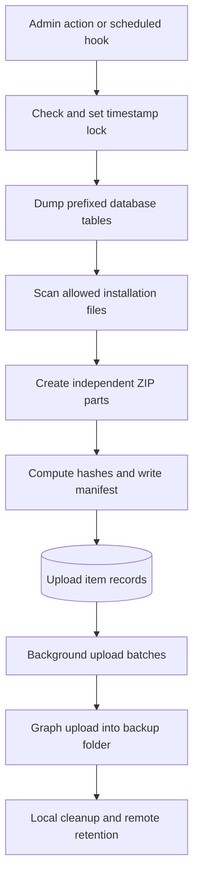

# Software Requirements Specification — WordPress SharePoint Backup Plugin

Document version: 1.0  
Review date: 11 November 2026  
Scope: `plugin/` source; packaged ZIP assessed separately  
Basis: all 21 source PHP files, including bootstrap, admin, REST, storage, backup, restore, scheduler, database, helpers and logging.

## 1. Purpose and status conventions

The plugin creates WordPress database/file backups, uploads them to SharePoint through Microsoft Graph, schedules recurring work, exposes remote management endpoints, restores backups and performs database URL migration.

This SRS is derived from source. **Implemented** means an implementation exists; **Partial** means its limitations materially affect the requirement; **Required gap** identifies behavior needed for reliable operation but not established by the supplied implementation. Acceptance scenarios are proposed checks, not executed production tests.

The Laravel dashboard in `../dashboard/` is an optional remote client. The Python SEO backend requires a different connector (`seo-agentic-connector`); this plugin does not implement that connector's `sac` APIs, article publishing, Yoast synchronization or reverse-push protocol.

## 2. Runtime and actors

| Item | Declared or observed requirement |
|---|---|
| Plugin identity | WordPress SharePoint Backup Plugin; `SPSYNC_VERSION` 1.0.0 |
| Declared compatibility | PHP 7.4+, WordPress 6.0+ in entry header; not fully compatibility-tested |
| Database | WordPress `$wpdb` with MySQL-style SQL |
| Archive support | ZipArchive preferred; WordPress PclZip fallback |
| Scheduling | Action Scheduler if present; WP-Cron fallback; Action Scheduler is not bundled here |
| Filesystem | Read WordPress installation; write uploads backup/restore directories; overwrite installation during restore |
| Network | Microsoft identity token endpoint and Microsoft Graph v1.0; signed Graph download/upload URLs |
| Administration | WordPress user with `manage_options` |
| Remote management | Client possessing `X-SPSYNC-KEY` |

Microsoft application permissions and tenant consent must be provisioned externally. The source requests Graph's `.default` scope; it does not grant permissions or prove the tenant's actual authorization configuration.

## 3. Code structure

| Path | Responsibility |
|---|---|
| `schedule-backup-plugin.php` | Metadata, constants, namespace autoloading, activation and component hooks |
| `admin/SettingsPage.php` | Four-tab settings/overview/log UI, configuration save, connection/manual-run/reset-lock actions |
| `api/RestController.php` | Shared-key authentication and nine remote endpoints |
| `database/Installer.php` | Four custom tables and initial settings/API key |
| `database/DatabaseMigrator.php` | URL matching, recursive serialization-aware replacement and cache flushing |
| `helpers/Settings.php`, `Encryption.php` | Custom settings persistence; client-secret encryption/decryption |
| `logger/Logger.php` | Structured database logs and daily 30-day cleanup |
| `auth/OAuth.php` | Client-credentials token acquisition and transient caching |
| `auth/GraphClient.php` | Graph requests and cached site/drive/root-folder discovery |
| `backup/BackupEngine.php` | Local backup orchestration and upload queue creation |
| `backup/DatabaseBackup.php` | SQL dump of prefix-matching tables |
| `backup/FileScanner.php` | Installation traversal and exclusions |
| `backup/ZipBuilder.php` | Independent ZIP parts grouped by input size |
| `backup/Retention.php` | Oldest matching remote folder pruning |
| `queue/QueueManager.php` | Background batches and upload completion cleanup |
| `storage/SharePointStorage.php` | Remote backup folders, small uploads and chunk sessions |
| `scheduler/Scheduler.php` | Calendar start-time calculation and cron event setup |
| `restore/RestoreManager.php` | Restore queue and phase transitions |
| `restore/DownloadManager.php` | Stream remote files to disk and check expected SHA-256 |
| `restore/RestoreEngine.php` | ZIP extraction, batched SQL execution and rollback snapshot |
| `schedule_backup_plugin.zip` | Existing distribution artifact; its 21 PHP entries match the 21 supplied PHP source files byte for byte at review time |

### Bootstrap detail that affects deployment

Namespaces use capitalized components (`SPSync\Database`, `SPSync\Api`, etc.), but directories are lowercase (`database`, `api`, etc.). The autoloader preserves namespace casing when building paths. On a case-sensitive filesystem, it therefore looks for paths such as `Database/Installer.php` that do not match the supplied `database/Installer.php`. This is a source-derived deployment defect; Windows path behavior can conceal it.

## 4. Functional requirements

| ID | Requirement / observable behavior | Status and source |
|---|---|---|
| P-FR-01 | On activation, create/upgrade settings, logs, upload-items and restore-items tables without replacing existing settings. | Implemented — `Installer::activate` |
| P-FR-02 | Generate a random API key and seed manual schedule, root folder, encryption flag and 30-backup retention. | Implemented — installer |
| P-FR-03 | Restrict WordPress admin actions to `manage_options` and validate nonces. | Implemented — settings page |
| P-FR-04 | Save Microsoft credentials, library/folder selection, schedule options and retention; allow API-key regeneration. | Implemented with encryption-toggle caveat |
| P-FR-05 | Retrieve a Microsoft client-credentials token, cache it with an expiry buffer, resolve SharePoint site/drive/folder, and create missing root folder. | Implemented — OAuth/Graph client |
| P-FR-06 | Export table structure/data for tables matching the active WordPress prefix using 500-row fetch batches. | Implemented — database backup; no transaction snapshot guarantee |
| P-FR-07 | Scan the WordPress installation, excluding backup/cache/temp/log directories and archive/log/temp extensions. | Implemented — file scanner |
| P-FR-08 | Build independent ZIP parts from groups targeting 52,428,800 input bytes, with ZipArchive or PclZip. | Implemented — zip builder; individual oversized files are not split |
| P-FR-09 | Produce SQL, ZIP files and a manifest with metadata, per-part sizes and SHA-256 hashes; enqueue every component including manifest. | Implemented — backup engine |
| P-FR-10 | Prevent ordinary overlapping backups using a timestamp lock, considering locks older than ten minutes stale. | Partial — non-atomic lock; manual action overrides it |
| P-FR-11 | Process upload batches, default five files, using Action Scheduler or WP-Cron. | Implemented — queue manager |
| P-FR-12 | Upload files below 4 MiB directly; use 3,276,800-byte chunks for larger files. | Implemented — storage |
| P-FR-13 | Retry chunk network/throttle failures and retry whole-file attempts, marking permanent failure. | Partial — some early errors bypass retries |
| P-FR-14 | Remove local backup files after successful queue completion and enforce retention. | Partial — final-batch bookkeeping does not establish all-job success |
| P-FR-15 | Schedule manual, daily, weekly, monthly and one-time backups at a selected WordPress-local start time. | Partial — monthly recurrence is fixed 30-day interval |
| P-FR-16 | Expose health, diagnostics, latest backup status, logs and remote connection test behind shared-key authentication. | Implemented — REST controller |
| P-FR-17 | Discover remote backup folders and mark known absent backup IDs missing. | Partial — no completeness/hash validation or pagination |
| P-FR-18 | Before restore, create local rollback SQL and selected-file snapshot, download manifest and enqueue manifest parts. | Implemented preparation, with coverage/concurrency limitations |
| P-FR-19 | Stream downloads, check supplied SHA-256, retry downloads, extract ZIP parts and import SQL in resumable batches. | Partial — SQL error handling and self-overwrite issues |
| P-FR-20 | On restore failure, attempt rollback and expose failed state. | Partial — rollback is incomplete and SQL batch completion is not guaranteed |
| P-FR-21 | Perform dry-run/live URL replacement across prefix-matching text-like columns while preserving recognized PHP serialized data. | Implemented with query/error/security limitations |
| P-FR-22 | Keep execution logs with severity/context and prune entries older than 30 days daily. | Implemented — logger |
| P-FR-23 | Preserve custom data on deactivation. | Implemented — empty deactivation hook; no uninstall implementation supplied |

## 5. Backup operation in detail

### Artifact contract

- Backup ID: `spsync-backup-YYYYMMDD-HHMMSS`, generated using WordPress local time.
- Local directory: `{uploads_basedir}/spsync-backups/{backup_id}/`.
- Files: `database.sql`, `backup_part001.zip` and following parts, `manifest.json`.
- Manifest: `backup_id`, UTC timestamp, WordPress/PHP/plugin versions, `backup_type: full`, `parts` array.
- Each part describes `filename`, `filesize`, `checksum`. The manifest itself is queued and hashed locally but is not included in its own parts array.
- Remote path: selected library → configured root folder → backup ID folder → artifacts.

Despite the `full` label, excluded file types/directories are not backed up. The scanner excludes directories named `.git`, `node_modules`, `cache`, `logs`, `tmp`, `spsync-backups` and extensions `log`, `tmp`, `zip`, `gz`, `tar`. SQL export includes plugin control tables because they share the WordPress prefix.

ZIP parts are separate archives, not byte segments of one multi-volume ZIP. The split threshold measures uncompressed input sizes; it is not a hard compressed-output size limit. Backup creation is synchronous within the worker/admin request and builds the file list in memory.

### Upload states and retries

Item states are `queued`, `uploading`, `done`, `error`, and later `missing`. Workers select queued/uploading rows with retries below three. Normal failed uploads requeue until the third attempt. Missing local files or failure resolving the destination folder immediately set `error`.

Chunk requests allow three attempts for network failures or throttling. Network waits are `retries * 2` seconds, a linear sequence rather than the exponential backoff described in a comment. Throttling uses `Retry-After` where available. Other chunk HTTP failures terminate that session. Whole-file retries create a new session; byte offsets and upload sessions are not persisted across workers.

The queue is global across backups. Final cleanup uses the first item of the last batch and the current batch's failure flag. It does not independently verify success of every item in every backup before deleting local files or enforcing retention.

## 6. Restore and migration operation

### Restore phases

`downloading → extracting → restoring_database → cleanup → completed`; failure paths attempt rollback and set `failed`.

1. `start_restore()` creates rollback artifacts synchronously before retrieving the remote manifest.
2. It sets active job/backup/status settings and truncates the shared restore queue.
3. Each download worker processes one part, finds its expected hash in the manifest and retries up to three times.
4. Extraction writes ZIP content directly into `ABSPATH`.
5. SQL import parses semicolon-terminated lines and checkpoints after 500 statements using `restore_db_offset`.
6. Cleanup removes downloaded and rollback artifacts, then records completion.

Rollback SQL covers prefix-matching tables. Rollback files cover themes, plugins, `wp-config.php` and `.htaccess`; they do not cover the full core installation or uploaded media. ZIP extraction overwrites files but does not remove all files created after the backup.

### Material restore limitations

- No restore/backup mutual exclusion or restore-specific atomic lock is present. A second restore can truncate the first job's queue and overwrite shared paths/settings.
- Database restore ignores `$wpdb->query()` failures. A missing/unreadable SQL file returns the same truthy result used for completion.
- Database dumps include `spsync_settings`, logs and queue tables. Restoring them can overwrite the active restore job and progress state while the worker is running.
- SQL restore offset is global and is not explicitly cleared at the beginning of a new normal restore.
- Rollback invokes `restore_database()` only once; SQL exceeding one 500-statement batch is not driven to completion by that method.
- Extraction's restored-flag update matches the literal filename `%.zip` with equality rather than a SQL `LIKE` expression.
- Manifest filenames are used to build local paths and ZIPs extract into the installation without explicit manifest path/ZIP-entry containment validation in this code.
- The manifest is downloaded without an independent trusted expected hash/signature. Part hashes detect mismatch against that manifest, not malicious replacement of both.
- Restore status is nested in backup status only after a latest backup queue record is found. A fresh migration target without backup records can return `idle` without restore information.

### URL migration

`DatabaseMigrator::search_and_replace()` trims URLs, rejects missing/equal values, scans prefix-matching tables, excludes the four plugin control tables, identifies text-like columns and locates matching rows. It recursively replaces strings inside recognized serialized strings, arrays and object properties, then serializes values again. A primary-key column is used where available; otherwise the original row is the match condition.

Dry run computes counts and writes execution logs but skips target-row changes. Live mode also sets `siteurl` and `home` to the new URL regardless of whether the old URL matched them, then flushes rewrite rules/cache. Reported counts track intended changed rows rather than confirmed successful SQL writes.

The candidate-row `LIKE` condition is assembled with `esc_like()` but not a prepared value; SQL quoting and hostile input handling require correction. `unserialize()` is used without restricting allowed object classes. Full candidate result sets are loaded into memory.

## 7. REST interface specification

Base: `{wordpress_url}/wp-json/spsync/v1/`.

Authentication: all nine routes use `check_auth()`. Missing configured key returns 403. Missing/wrong incoming key returns 401. Valid key is compared with `hash_equals()`. It grants the complete remote command set; there are no scoped API permissions.

| Method | Endpoint | Input and response |
|---|---|---|
| GET | `health` | Plugin identity/version/database status/timestamp; HTTP 200 even when diagnostic database state is `missing_tables` |
| POST | `connection/test` | Refresh token and rediscover cloud IDs; 200 success or 400 failure |
| GET | `system/info` | Versions, limits, DB size, SharePoint folder and disk data |
| GET | `backup/status` | Latest job aggregate, phase, progress and counters; restore job/status when a backup exists |
| POST | `backup/start` | Enqueue scheduled-backup hook; return 202 with generated backup ID |
| POST | `restore/start` | Require `backup_id`; prepare restore, return 202/job ID or error |
| GET | `logs` | Default limit 50, maximum 100, newest-first |
| GET | `backups/verify` | Verified/missing/remote identifier arrays and remote count |
| POST | `database/search-replace` | Require `old_url`, `new_url`; boolean-like `dry_run`; return table/row/replacement counts and duration |

The ID returned by `backup/start` is generated before execution and is not passed to `BackupEngine::run()`, which generates its own ID later. Consumers must not assume these identifiers are identical.

Remote verification reads one Graph children response. It accepts any returned folder name as a remote backup, with additional loose file-name handling, and does not inspect manifest/part validity. A failed children request can be treated as an empty listing and cause local jobs to be marked missing. Already-missing item rows are not restored to `done` when a folder reappears.

## 8. Data and configuration

| Table (WordPress prefix prepended) | Required data |
|---|---|
| `spsync_settings` | Key/value text settings; primary key `option_name`; credentials, cloud IDs, schedule, active locks/jobs/offsets |
| `spsync_logs` | ID, level, message, JSON context, UTC created time |
| `spsync_items` | Backup ID, filename, size, status, retries, SHA-256, UTC created time |
| `spsync_restore_items` | Restore job ID, filename, state, retries, downloaded/restored flags, UTC created time |

Cloud site/drive/root IDs persist in settings. OAuth token uses a transient, cached for `max(60, expires_in - 300)` seconds. Individual remote backup-folder IDs use one-hour transients. Connection testing clears persistent discovery IDs before rediscovery.

Client-secret encryption uses AES-256-CBC, random IV and a key derived from WordPress salts. The no-OpenSSL fallback is base64 encoding, which is not encryption. API keys are stored as plain settings values. The save handler writes the secret before writing the encryption flag, so changing that flag can make existing stored secret values unreadable or incorrectly interpreted.

## 9. Scheduling and retention

- Daily uses WordPress's daily interval; weekly uses seven days.
- Monthly calculates an initial selected day clamped to 1–28, then repeats every 30 days. This can drift from the selected calendar date.
- One-time invalid/past date falls back to one hour from now rather than rejecting it.
- After the scheduled hook, `once` is reset to manual even if backup generation fails.
- Manual admin backup deletes the lock and invokes the engine with force override.
- Deactivation does not clear backup/upload/restore/log cleanup hooks.
- Retention defaults to 30; a nonpositive limit skips pruning. Matching `spsync-backup-` folders are sorted by name, oldest first. Only one listing page is inspected.
- Retention deletes corresponding queue rows without checking whether the remote DELETE succeeded, potentially losing local tracking for a still-present backup.

WP-Cron timing depends on an external cron driver or site traffic. No exact execution-time guarantee is established. Multiple sites using the same cloud root can affect each other's discovered backups and retention because the folder hierarchy has no enforced site-identity level.

## 10. Nonfunctional requirements

| ID | Requirement | Assessment |
|---|---|---|
| P-NFR-01 | Load correctly on supported Windows and case-sensitive Linux installations. | Required gap — namespace/directory case mismatch |
| P-NFR-02 | Authenticate all remote destructive operations and authorize admin forms. | Implemented key/capability/nonce checks; key rotation and scoped access need operating policy |
| P-NFR-03 | Ensure TLS verification for cloud calls. | Implemented on normal token, Graph, upload and download requests |
| P-NFR-04 | Protect local backup, restore and rollback artifacts from web access. | Partial — backup directories get Apache denial/index files; equivalent protection for all shared restore/rollback paths and other servers is not established |
| P-NFR-05 | Preserve recoverable job state across process failures and self-restoration. | Required gap — non-atomic/global control state and backed-up control tables |
| P-NFR-06 | Do not report restore/rollback success after SQL or file failure. | Required gap — unchecked SQL and partial rollback |
| P-NFR-07 | Verify every backup component before retention/local deletion. | Required gap — current completion and verification logic are insufficient |
| P-NFR-08 | Constrain all filesystem writes/extraction to intended destinations. | Required gap — explicit manifest and archive path validation needed |
| P-NFR-09 | Enforce retention over the complete remote inventory and only after confirmed deletion. | Required gap — pagination and delete-result handling |
| P-NFR-10 | Bound memory and work on large sites. | Partial — row/chunk batching exists, but scanning, migration and some archive work hold full collections |
| P-NFR-11 | Provide repeatable backup/restore integration tests. | Required gap — no plugin test suite supplied |

No backup encryption-at-rest feature for SQL/ZIP artifacts, incremental backups, verified point-in-time database consistency, multisite-wide orchestration, or measured RTO/RPO is implemented or established by the inspected source.

## 11. Acceptance scenarios and validation status

| ID | Expected verification | Related requirements |
|---|---|---|
| P-AC-01 | Activate on a clean and already-configured site; tables/key/defaults are created idempotently and existing credentials survive. | P-FR-01–02 |
| P-AC-02 | Load on a case-sensitive Linux host and exercise every autoloaded component. | P-NFR-01 |
| P-AC-03 | Reject unauthorized REST/admin actions; accept correctly authenticated calls. | P-FR-03, 16 |
| P-AC-04 | Back up fixture data with serialized values, NULLs, binary/text content and large tables; compare restored data and file hashes. | P-FR-06–09, 19 |
| P-AC-05 | Exercise files below/above 4 MiB, oversized individual files, network failures, 429s and interrupted uploads. | P-FR-08, 12–13 |
| P-AC-06 | Fail an early upload batch and succeed a later batch; no incomplete backup should lose local recovery artifacts. | P-FR-14, P-NFR-07 |
| P-AC-07 | Verify absent, reappearing, incomplete and paginated backups without turning listing failures into missing-backup claims. | P-FR-17, P-NFR-09 |
| P-AC-08 | Restore on a fresh target and through all phases; plugin state remains usable while its own tables/files are restored. | P-FR-18–20, P-NFR-05 |
| P-AC-09 | Inject SQL errors and rollback dumps exceeding 500 statements; terminal result must reflect complete recovery or failure. | P-NFR-06 |
| P-AC-10 | Dry-run/live migration on nested serialized values, quoted URLs and tables without simple primary keys. | P-FR-21 |
| P-AC-11 | Test calendar recurrence, one-time failure, deactivation and multiple sites sharing cloud roots. | P-FR-15, P-NFR-09 |

All 21 plugin PHP source files were included in a combined 60-file PHP syntax check with no syntax errors using PHP 8.3.30. A separate SHA-256 comparison found all 21 packaged PHP files identical to the supplied PHP source files. WordPress and SharePoint integration, actual restores, database migration and PHP 7.4 compatibility were not established by these checks. No live backup, restore, migration or retention operation was executed during this review.

Open decisions: supported server/filesystem platforms, backup exclusion policy, per-site cloud isolation, full versus selective rollback coverage, lock/job identity design, trusted artifact format, and recovery targets.
