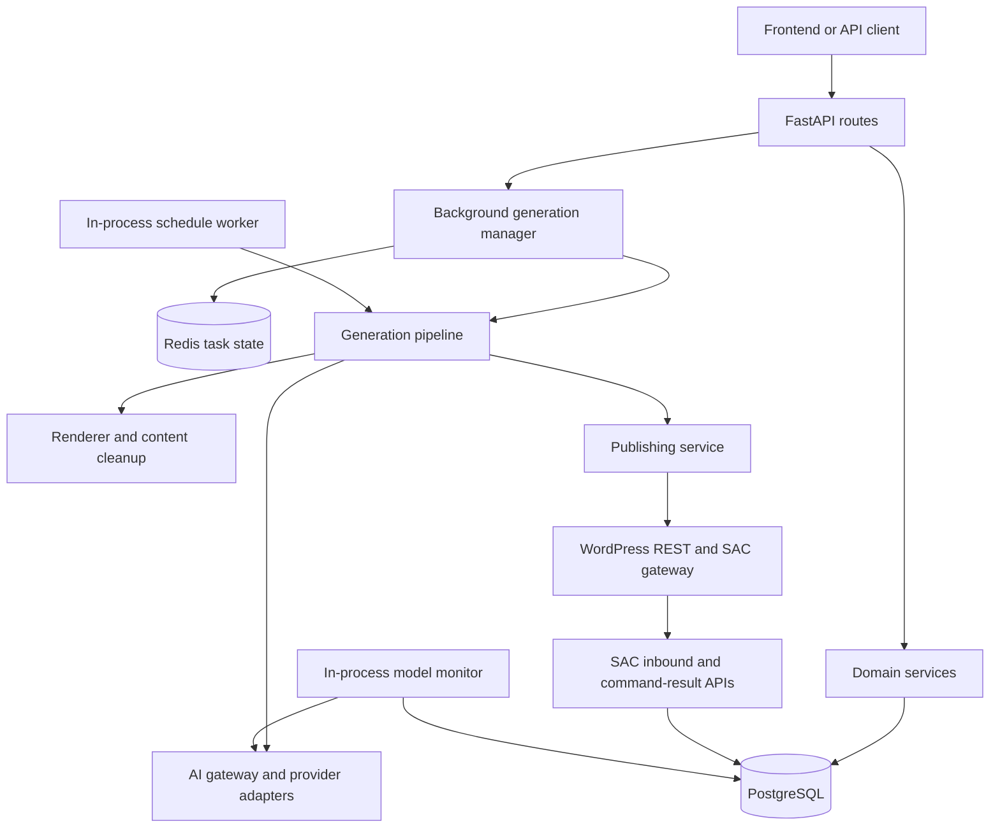

# Software Requirements Specification — SEO Agentic Backend

Document version: 1.0  
Review date: 11 November 2026  
Scope: `seo_agentic_backend_package 1/`  
Application version: `0.2.0` from `VERSION`  
Basis: application entry/configuration, route declarations, models/schemas, core service implementations, workers, migrations, deployment files and existing tests.

## 1. Purpose and interpretation

This Python service manages client SEO profiles and products, researches brand context, generates and revises articles through configurable AI providers, renders branded content, publishes to WordPress, manages automated schedules, tracks AI usage/budgets, and monitors provider model catalogues.

This is a reverse-engineered specification of the supplied backend. **Implemented** means source exists; **Partial** means the implementation has an important qualification; **Required gap** identifies missing assurance or behavior. Acceptance criteria are proposed verification scenarios, not claims of completed live testing.

The folder is a backend package, not a complete browser frontend. Its `/api/dashboard` endpoint is an SEO statistics API; it is unrelated to the Laravel backup dashboard in `../dashboard/`. No direct calls between this backend and the SharePoint backup system were found in the reviewed integration paths.

## 2. Actors, dependencies and boundaries

| Actor / dependency | Responsibility |
|---|---|
| Authenticated operator | Manage profiles/products/articles; generate, revise, review, publish and schedule |
| Admin | Review discovered AI models, validate/configure catalogue entries, enable approved models |
| API consumer/frontend | Present JSON data, consume SSE progress and poll background tasks |
| WordPress installation | Store articles, media, categories, tags and publish state |
| SEO Agentic Connector (SAC) | Separate WordPress plugin supplying token-authenticated gateway, metadata, styling and reverse-push features |
| AI providers | Ollama, Anthropic Claude, Google Gemini, Groq and OpenAI adapters |
| PostgreSQL | Durable application, article, schedule, audit and model-monitor data |
| Redis | Background-generation state, running set, FIFO waiting list and notification publication |
| Optional external services | Pexels, Unsplash, context.dev, Google Indexing API |

The supplied `../plugin/` is **not** SAC. It exposes `spsync/v1` backup APIs and cannot satisfy the backend's SAC gateway requirements. SAC's expected source folder, `wordpress-plugin/seo-agentic-connector`, is absent from these three supplied project folders. Connector download/update functionality therefore requires additional deployment material.

### Runtime baseline

- Docker specifies Python 3.12; setup documentation says Python 3.10+. The existing local environment ran the tests on Python 3.13. These are separate observations, not proof of compatibility across all those versions.
- `requirements.txt` pins FastAPI, Uvicorn, SQLAlchemy, PostgreSQL driver, Redis, Pydantic, HTTP clients, JWT/password/encryption libraries, APScheduler, croniter, JSON repair, Google authentication and pytest packages.
- The bundled `.venv` is usable locally but must not be assumed to reproduce `requirements.txt` exactly; observed test warnings reported a different Pydantic version from the requirements pin.
- Configuration is loaded from `.env` by `app/config.py`. Real environment secret values were not copied into this document.
- Database engine config uses connection pre-ping, pool size 10, overflow 20. Startup uses PostgreSQL-specific additive ALTER statements.

## 3. Architecture and structure

| Path | Responsibility |
|---|---|
| `app/main.py` | Logging, model registration, table creation/schema patching, CORS, router registration, startup recovery and workers |
| `app/config.py`, `database.py`, `version.py` | Settings, SQLAlchemy sessions/engine and version metadata |
| `app/routes/` | 19 route modules plus package initializer; request/response schemas also appear inline in several modules |
| `app/models/` | Users, clients, profiles/products, articles/templates, WordPress data, scheduling, usage/budgets, events/notifications and AI governance |
| `app/schemas/` | Shared auth/client/product/schedule/WordPress request and response contracts |
| `app/services/article_generation_service.py` | Prompts, brand context, AI calls, section drafting, checkpoints, sanitation, FAQ, SEO, QA and revisions |
| `app/services/article_renderer.py` | Markdown/custom blocks → article HTML, CSS, JavaScript, structured data and preview |
| `app/services/generation_task_manager.py` | Redis lifecycle plus daemon threads for background generation |
| `app/services/publishing_service.py` | WordPress post lifecycle, image preparation, SAC metadata/styling, Elementor and SEO integration |
| `app/services/publishing_readiness_service.py` | Detailed readiness checks, primarily enforced for automatic publishing |
| `app/services/wordpress_service.py`, `sac_gateway.py` | Connectivity, native REST/SAC access, sitemap/media synchronization |
| `app/services/wp_command_service.py` | Reverse-push command queue when supported outbound operations are blocked |
| `app/services/ai_gateway/` | Provider adapters, task routing, token/cost response model and pricing |
| `app/services/ai_model_*` | Model discovery, lifecycle, metadata hints, catalogue validation/enablement and audit |
| Other `app/services/` modules | Research/design/import, images, Google indexing, budgets, auth/client/audit, events and notifications |
| `app/workers/` | APScheduler article schedule worker and model discovery worker |
| `app/utils/` | Auth dependency, JWT/password handling, Fernet encryption, errors and scheduling math |
| `migrate_*.sql`, migration Python script | Incremental deployment/schema/content updates; not a unified migration history |
| `tests/` | Seven existing test modules covering selected generation, rendering, scheduling, version and model governance behavior |
| `Dockerfile`, `run.sh`, `deploy-backend.sh` | Deployment helpers with external-path/layout assumptions |

There are 96 application Python files, approximately 18,320 application lines at review time. The two largest modules are the renderer and generation pipeline; publishing is another major concentration of behavior.

### Startup behavior

Importing `app.main` can connect to the database and create/alter schema before application startup events. It imports route-defined platform settings models before `Base.metadata.create_all()`, ensuring those tables are registered too. `_ensure_schema()` applies additive statements in one transaction, logging failure rather than making startup success conditional on every patch. It then attempts to load encrypted platform keys into process settings.

Startup events recover stale Redis generation tasks and start both in-process schedulers if enabled. Shutdown stops schedulers. `/health` returns version metadata and a constant healthy response; it does not establish PostgreSQL, Redis, WordPress or provider readiness.

## 4. Functional requirements

### Identity, client data and research

| ID | Requirement | Status / source |
|---|---|---|
| S-FR-01 | Register users with unique username/email, hash passwords, log in and issue signed expiring JWTs. | Implemented — auth routes/service/security; registration currently assigns admin |
| S-FR-02 | Validate bearer token and active user on protected APIs. | Partial — dependency exists but is not applied to every management router |
| S-FR-03 | Create/read/update/delete clients; provide server-side search, filtering, sorting and pagination. | Partial — client router uses caller-supplied/default `user_id=1`, not verified JWT ownership |
| S-FR-04 | Maintain a one-to-one client profile with identity, brand voice, audiences, USPs, rules, statistics, certifications, internal links, language and publishing defaults. | Implemented — profile routes/model |
| S-FR-05 | Research profile content, detect design tokens, and offer a streamed multi-stage website/competitor/voice research wizard. | Implemented with external-service dependence — research/design services |
| S-FR-06 | Return full research wizard results for review rather than automatically persisting the complete proposed profile. | Implemented — `run_research_wizard`; other profile actions have their own save behavior |
| S-FR-07 | Import profile-tab content and deduplicate products/links where supported. | Implemented — smart import service/profile routes |
| S-FR-08 | Manage ordered client products/services with benefits, keywords, audience and landing page data. Exclude internal remarks from AI brand context. | Implemented — product routes/context builder; covered by existing tests |
| S-FR-09 | Maintain templates with parent inheritance and child overrides. | Implemented storage/API inheritance; renderer consumption is qualified below |

### Articles, generation and rendering

| ID | Requirement | Status / source |
|---|---|---|
| S-FR-10 | Create/list/filter/update/delete articles; support brief-first drafts with provisional titles and generated slugs. | Implemented — articles router |
| S-FR-11 | Create 1–20 article drafts in a bulk request, then independently submit generation tasks and report queue failures per article. | Implemented — bulk create; notification user attribution currently hardcodes ID 1 |
| S-FR-12 | Accept creative brief, ideas, required content, taboos, tone/image constraints and language. | Implemented — article model, schemas and generation prompts |
| S-FR-13 | Build generation context from profile, relevant products, links and article input, while warning about overlapping existing content. | Implemented — context/gap detection |
| S-FR-14 | Generate structured brief, introduction/body/conclusion sections, FAQ and SEO metadata through task-routed AI. | Implemented — generation pipeline |
| S-FR-15 | Save generation checkpoints and reuse completed steps/sections when generation is resumed. | Partial — checkpoint JSON persistence needs interruption testing |
| S-FR-16 | Offer legacy SSE generation and optional detached background generation with progress polling/SSE. | Implemented — generation routes/task manager |
| S-FR-17 | Limit detached generation concurrency/queue size and reject duplicate active tasks; support cancellation and timeouts. | Partial — non-atomic admission and cooperative cancellation |
| S-FR-18 | Sanitize draft link/image placeholders, resolve link targets, check language consistency and limit image placeholders. | Implemented — sanitation service; not a general untrusted-content sanitizer |
| S-FR-19 | Render branded article HTML with headings, navigation, summaries, FAQ, CTA, references, social components and custom content blocks. | Implemented — renderer |
| S-FR-20 | Produce CSS and JSON-LD separately from post content for SAC delivery; provide preview HTML. | Implemented — renderer and publishing |
| S-FR-21 | Score QA checks and set generated article to `review` at 70% or higher, otherwise `draft`. | Implemented — `run_qa`, generation completion |
| S-FR-22 | Revise full article or an indexed section from instructions; retain revision history and rerender/reassess where implemented. | Implemented — revision endpoints and generation service |
| S-FR-23 | Support image source choices `wp_media_first`, `stock_first`, `wp_media_only`, `stock_only`, reuse saved image mappings and honor configured image blocklists. | Implemented — image/publishing services |

### WordPress, publishing and SEO

| ID | Requirement | Status / source |
|---|---|---|
| S-FR-24 | Store an encrypted WordPress application password, test connections and retrieve categories/authors/site info/templates. | Implemented transport; management auth is incomplete |
| S-FR-25 | Synchronize sitemap/media data through SAC where available and native/fallback paths where supported. | Implemented — WordPress service |
| S-FR-26 | Accept reverse-pushed media/sitemap data using a matching per-client `X-SAC-Token`. | Implemented — inbound route |
| S-FR-27 | Push drafts, publish, update published content, unpublish, inspect/reconcile WP status and forget local WP linkage. | Implemented — publishing service/routes |
| S-FR-28 | Resolve/create taxonomy, prepare/upload images, choose featured media, set templates and optionally Elementor content. | Implemented with possible partial external failures |
| S-FR-29 | Synchronize CSS/schema/JS and Yoast metadata through SAC; queue supported commands for reverse execution when outbound access is blocked. | Partial — requires external connector; not every publishing failure becomes a queued command |
| S-FR-30 | Gate automatic publishing on readiness and run it after successful background or scheduled generation. | Implemented — readiness/task manager/worker |
| S-FR-31 | Provide milestone SSE for publish/push/update operations. | Implemented — threaded publishing stream |
| S-FR-32 | Optionally submit a published URL to Google Indexing after profile verification and configured credentials; record success/failure without reversing publication. | Implemented API submission; indexing outcome is not guaranteed |
| S-FR-33 | Serve SAC update metadata/version and a ZIP built from its deployed source folder. | Partial — source folder missing from supplied workspace |

### Automation, AI operations and observability

| ID | Requirement | Status / source |
|---|---|---|
| S-FR-34 | Create monthly/weekly/custom-cron schedules, keyword pools, defaults, active state and automatic publishing choice. | Implemented — schedules routes/schemas |
| S-FR-35 | Enqueue due runs, execute sequentially within a worker, consume keywords on success and optionally cycle an exhausted pool. | Implemented — schedule worker |
| S-FR-36 | Recover interrupted scheduled runs by checkpoint age; retry a failed normal run once after one hour and retain final failures/alerts. | Implemented — schedule worker/utilities |
| S-FR-37 | Expose schedule health, run history, test runs, retries, alerts and recovery log. | Implemented — schedules routes |
| S-FR-38 | Route eight AI task types to configured provider/model/temperature/token limits with per-request overrides. | Implemented — gateway/router |
| S-FR-39 | Persist encrypted provider/platform credentials, masked key views and runtime settings where supported. | Partial — settings-field mismatch and fallback handling need correction |
| S-FR-40 | Record AI usage/error/cost context; aggregate article/client-month usage and apply optional paid-provider USD/token budget caps. | Partial — estimate-based pre-call enforcement, fail-open on other budget errors |
| S-FR-41 | Discover provider models periodically, establish first-scan baseline, identify new/missing/recovered models and notify admins. | Implemented — monitor and worker |
| S-FR-42 | Require model approval, metadata/pricing, validation, stability classification and explicit enablement for governed catalogue entries. | Implemented catalogue workflow; static model/override paths are exceptions |
| S-FR-43 | Maintain audit events, operational events, schedule alerts and per-user notifications/read state. | Implemented with differing scopes and best-effort logging |
| S-FR-44 | Return public version/root/health data and authenticated SEO dashboard statistics. | Implemented — main/version/dashboard routes |

## 5. Article lifecycle and generation behavior

### Content and state

Article content includes raw Markdown, rendered HTML/CSS, SEO/OG fields, focus/secondary keywords, user brief/ideas/constraints, AI-produced `generation_brief`, revision history, generation checkpoint, word count and model metadata. WordPress fields include remote ID/status/URLs, categories/tags, template/Elementor choices, media mappings, featured media, comment/ping preferences, publication and SEO/indexing timestamps.

Platform statuses are `draft`, `review`, `approved`, `published`, `archived`. The remote `wp_status` is separate. The article-status endpoint can set local `published` state and a timestamp without actually publishing to WordPress; remote publication must be verified separately. A stored approved/review state and a QA percentage are not independently verified factual accuracy or search-ranking guarantees.

### Generation sequence

1. Load article, profile and ordered products; construct context and detect possible topic overlap.
2. Load saved checkpoint. Produce/reuse structured brief; replace provisional title/keyword when the brief supplies them.
3. Generate/reuse the introduction, individual body sections and conclusion, saving intermediate results.
4. Clean link/image placeholders and warn on language inconsistency.
5. Generate/reuse FAQ and SEO fields; FAQ or SEO failures can become warnings rather than aborting the entire run.
6. Render HTML/CSS. Rendering failure also becomes a warning in the pipeline.
7. Run QA, set `review`/`draft`, clear the generation checkpoint and emit completion.

QA currently has 21 equally weighted checks, including word count, keyword placement/density, headings, FAQ, summaries, links, references, images, metadata length, rendering, language and user constraints. The schema check looks for JSON-LD script text inside rendered HTML, although the renderer intentionally delivers JSON-LD separately through SAC; this can produce a false-negative QA check.

### Background mode

Redis keys: `gen:task:{article_id}`, set `gen:running`, list `gen:queue`. Defaults: three concurrent tasks, twenty waiting tasks, thirty-minute overall limit. Work itself runs in daemon threads inside the API process, not a dedicated external queue worker.

Task states include `queued`, `running`, `cancelling`, `completed`, `failed`, `failed_budget`, `failed_timeout`, `failed_interrupted`. Ordinary state TTL is one hour, completed tasks five minutes, failures ten minutes. Cancellation and overall timeout are checked while consuming yielded pipeline events; they do not forcibly stop an in-flight provider request. Per-AI-call helper timeout is hardcoded to 600 seconds, independent of the similarly named configurable step-timeout setting.

On startup the manager attempts to mark interrupted tasks failed and clear waiting tasks. Because `fail_task()` drains the queue during recovery, it can start queued work while recovery is still traversing stale state. Admission checks and running-set insertion are separate Redis operations, so the concurrency limit is not a distributed atomic guarantee.

Background completion may still be `completed` when automatic publication failed; progress detail/notifications distinguish that case. Completing a task also replaces the last step/detail, so consumers should use stored publication state and notifications rather than assuming the final generation label proves publication.

### Rendering contract

The renderer derives its CSS namespace and design values primarily from profile design tokens, institution name and fallbacks. It supports rich Markdown/custom blocks including tables, lists, accordions and carousels, builds article components, and removes leftover internal-link tokens/dead placeholder links in safety passes.

Although templates store HTML skeletons/settings and support inheritance in the template API, the main renderer does not consume the template skeleton as a generic template engine. Storing/selecting a template must not be assumed to make all template fields affect generated output.

Custom CSS has structural filtering and a 20,000-character cap. Custom JavaScript has closing-script-tag protection and a 40,000-character cap; it intentionally remains executable operator-supplied code. This is not a safe feature for untrusted tenants without a stronger authorization model.

## 6. Publishing and connector contracts

Native WordPress requests use application-password Basic authentication. SAC requests use a per-profile token and a separate connector namespace, implemented by the absent connector rather than this repository's backup plugin.

The publishing service prefers SAC post create/update where a token exists, then falls back to native `wp/v2`. Some update failures can cause a new post to be created. It resolves taxonomy and images, stores returned remote IDs/URLs and applies optional connector features. JSON-LD/CSS/JS are delivered outside normal post content to avoid WordPress content filtering/formatting problems.

`PublishingService.publish(mode="auto")` enforces strict readiness: connected WordPress, content/rendered HTML, no unfinished checkpoint, status `review`/`approved`, valid link output and viable image handling. Categories, template and SAC configuration can produce warnings. Manual publication does not call that same strict gate merely because the readiness helper supports a manual mode.

External changes are not transactional with PostgreSQL. Publishing a post can succeed while media, template, Elementor, Yoast or indexing updates fail. Several enrichments intentionally catch errors. A successful publish response therefore establishes the core publication path, not completion of every optional enhancement.

### Reverse command queue

Pending commands are selected per client, marked `processing`, returned to SAC and completed/failed through a token-authenticated callback. Failed commands return to pending until three failures, then become terminal `failed`. The supplied service has no timeout/reaper for commands stranded in `processing`.

The result endpoint authenticates the client token but completion/failure lookup is by command ID alone. It does not verify that the returned command belongs to that authenticated client. This is a cross-client authorization gap.

### Indexing behavior

The backend posts `URL_UPDATED` to Google's Indexing API using stored service-account JSON. Automatic submission requires profile verification, opt-in and configured credentials. Its local quota tracker is an in-memory per-process date counter (limit 200, warning 180), reset on restart; it is not an authoritative provider quota ledger. A successful notification response is recorded as submission, not proof of indexing, eligibility or ranking.

## 7. Schedule semantics and recovery

- APScheduler runs inside the FastAPI process, polling due article runs every 60 seconds and checking health every 300 seconds.
- Monthly schedules distribute a requested number over candidate days; weekly schedules prefer Mon/Thu/Tue/Fri/Wed/Sat/Sun. Weekly slot selection is effectively limited by the seven weekday choices.
- Custom cron uses croniter. Invalid expressions in low-level calculation fall back to a future daily time; route/schema validation must be considered separately.
- Scheduling math uses naive UTC datetimes and the scheduler's timezone is UTC. `settings.TIMEZONE` defaulting to Asia/Kuala_Lumpur does not itself convert `run_hour` to Malaysian local time.
- Runs are `pending`, `running`, `success`, `success_publish_failed`, `failed_will_retry`, `failed_final` or `skipped` in worker behavior.
- A normal first failure retries in one hour; a second failure is final. Test runs do not automatically retry.
- Recovery: checkpoint younger than one hour resumes, one to under six hours restarts, six hours or older aborts; missing checkpoint/time restarts.
- A running task without progress for more than 90 minutes is marked stuck/failed by health checks. This does not terminate its executing Python thread.
- Scheduled generation calls the pipeline directly, outside Redis generation-manager admission control. Three detached tasks plus scheduled work are therefore possible.
- Locks and APScheduler `max_instances` are process-local. Multiple Uvicorn processes can each start schedulers and contend for/duplicate work; the source does not supply distributed schedule claiming.

The schedule model's comment claiming all work is free/local Ollama is stale: provider/model overrides and global routing permit paid providers, and the budget service applies where client context is supplied.

## 8. AI gateway, budgets and model governance

Eight task types: `profile_research`, `article_draft`, `seo_meta`, `keyword_suggest`, `article_brief`, `article_faq`, `smart_import`, `general`. All defaults route to configured Ollama; stored routing overrides defaults. Explicit request provider/model overrides take precedence.

Provider adapters normalize content, token counts, duration and supported web-search metadata. The OpenAI adapter uses a streamed Responses request internally and provider-specific retries. A gateway exception is logged and raised; the gateway does not automatically switch all failed provider calls to a fallback provider.

Cost is estimated using the code's pricing tables/catalogue. It is not a verified provider bill. Budget enforcement checks recorded usage before paid calls when client context exists. Ollama is exempt; absent/disabled budgets and missing client IDs bypass enforcement. Other budget-check errors are swallowed. Concurrent calls can overshoot a cap because no prospective token/cost reservation occurs. Some research calls omit client context, so their usage cannot be assumed to count toward a client's cap.

### Model lifecycle

The model monitor defaults to scanning every 24 hours after a 60-second startup delay. First successful scan is a baseline. Later additions become pending review and notify admins. Missing models require consecutive successful scans (default threshold three, minimum two); failed scans preserve prior snapshots. Reappearing models recover to active.

Catalogue approval, pricing/capabilities/stability configuration, validation and enablement are distinct steps with audit records. Validation makes a small live text-generation request asking the provider to reply `OK`; a nonempty response passes. This request can incur provider cost and calls the adapter directly rather than the gateway's normal usage/budget logging path. It is not a comprehensive benchmark of generated content quality. Dynamically catalogued entries are checked by routing updates, while legacy static models and direct provider/model override paths do not all pass through the same governance gate.

## 9. Data requirements

| Domain | Tables and key relationships |
|---|---|
| Identity | `users`; `clients.owner_id → users` |
| Client knowledge | One `client_profiles` row per client; ordered `client_products`; JSON audiences, rules, links, design, media/sitemap caches |
| Articles | `articles → clients`, optional template; content, metadata, WP linkage, checkpoint/revision JSON |
| Templates | `article_templates` self-referencing parent; nullable child override fields |
| WordPress | Unique connection per client; encrypted password; category/author cache tables |
| Automation | `article_schedules → client/template/creator`; `scheduled_runs → schedule/article`; `schedule_keyword_pool → schedule/article`; `system_alerts` |
| AI use | `ai_provider_settings`, `ai_task_routing`, `ai_call_logs`, `client_ai_budgets` |
| AI governance | `ai_discovered_models`, `ai_model_scan_runs`, `ai_model_catalog_entries`, `ai_model_governance_audit` |
| Operations | `audit_logs`, `event_logs`, user-owned `notifications`, `wp_pending_commands` |
| Platform | `platform_api_keys`, defined in a route module rather than `models/`; ordinary settings share this table under `setting:`-prefixed keys |

SQLAlchemy client relationships cascade profiles/articles/products; schedules, connections and other foreign keys have separate deletion behavior. Client deletion with dependent records needs integration verification rather than assuming all associated data is cascaded.

Database tables are created on main-module import. Incremental SQL files cover later features, while startup only patches selected columns. Existing database upgrades therefore require matching schema history; `create_all()` alone does not upgrade an existing table's columns. The `migrate_rerender_breadcrumbs.py` helper is a content rerender operation as well as a migration-related artifact and should be reviewed before use.

Fernet credentials derive their encryption key from `SECRET_KEY`; rotating that setting without a data re-encryption plan makes stored credentials unreadable. Several reads fall back to the stored string on decryption failure, which can hide corruption/key mismatch. SAC token remains a normal string profile field.

## 10. API families and access model

All paths are relative to the service root. Appendix A gives the full static route inventory.

| Family | Responsibilities | Current protection |
|---|---|---|
| `/api/auth` | Register, login, current user | Register/login public; `/me` manually checks JWT |
| `/api/clients` | Client CRUD, profile/research, WordPress management, products | Mixed: profile/products protected; client CRUD and most connection management lack JWT dependency |
| `/api/templates` | Template CRUD/inheritance | No router-level or handler JWT check found |
| `/api/articles` | Article CRUD, generation/revisions, rendering, publication and SEO state | Bearer dependency on relevant routers |
| `/api/ai` | Provider config/routing, usage/budgets, model discovery/catalogue/governance | Bearer; selected discovery/governance actions additionally require admin |
| `/api/platform` | Platform settings and encrypted API keys | Bearer; not universally admin-only |
| `/api/schedules` | Schedules, runs, retry/recovery/health/alerts | Bearer |
| `/api/dashboard`, `/api/events`, `/api/notifications` | Statistics/events/per-user notification operations | Bearer |
| `/api/indexing` | Google service-account/access tests and submission | Bearer |
| `/api/sac` | Connector version/update metadata/download | Public by design |
| WordPress inbound/pending/result paths | SAC reverse communication | Per-client SAC token; callback ownership gap described above |
| `/api/settings`, `/`, `/health`, `/api/version` | Public configuration/version diagnostics | Public |

Authentication is not equivalent to resource ownership. Many protected handlers look up articles/clients by ID without a corresponding current-user ownership constraint. No consistent multi-tenant isolation layer is established by this package.

## 11. Nonfunctional requirements and material gaps

| ID | Requirement | Current assessment |
|---|---|---|
| S-NFR-01 | Authenticate all private management operations and authorize resource access by role/ownership. | Required gap — mixed JWT coverage, default user IDs and ID-only lookups |
| S-NFR-02 | Prevent public registration from granting administrative privileges. | Required gap — auth service sets `role="admin"` |
| S-NFR-03 | Restrict browser origins to configured clients and use an intentional credential policy. | Required gap — wildcard CORS with credentials enabled |
| S-NFR-04 | Protect provider/WordPress credentials at rest and support safe key rotation. | Partial — Fernet exists; fallback/default-secret/rotation policy unresolved |
| S-NFR-05 | Validate outbound fetch destinations and treat fetched/AI content as untrusted. | Required gap — arbitrary research/site/image URLs and trusted rendering/custom JS need stronger boundaries |
| S-NFR-06 | Preserve task admission, schedule execution and recovery correctness across processes. | Required gap — non-atomic Redis operations and process-local schedulers/locks |
| S-NFR-07 | Distinguish generation success, post publication and optional enrichment completion. | Partial — separate data exists; catches and completion-label overwrites can obscure failure |
| S-NFR-08 | Use durable checkpoints with well-defined SQLAlchemy JSON mutation behavior. | Partial — plain JSON columns and mutated checkpoint dictionaries need restart/resume integration tests |
| S-NFR-09 | Enforce client budgets consistently and audit all paid usage. | Partial — missing context, best-effort logging, pre-call recorded-usage check and concurrency overshoot |
| S-NFR-10 | Keep health endpoints truthful about dependencies and schema readiness. | Required gap — shallow health, swallowed startup failures and partial schema patching |
| S-NFR-11 | Avoid blocking API event loops and invalid cross-thread session use during long generation. | Partial — legacy SSE drives synchronous generator; helper AI calls use the passed session from a worker thread |
| S-NFR-12 | Deliver provider-wait heartbeats promptly and honor cancellation/timeout deadlines. | Partial — pipeline buffers heartbeats until `_run_ai()` returns, so consumers can see long silent periods |
| S-NFR-13 | Validate SAC callback ownership and recover stranded processing commands. | Required gap — ID-only completion lookup and no processing lease recovery |
| S-NFR-14 | Reproduce dependencies and deploy from the actual package layout. | Required gap — bundled environment drift, external paths and missing connector source |
| S-NFR-15 | Keep QA aligned with rendered output and assert publishing readiness where intended. | Partial — separate JSON-LD false-negative check; strict readiness only enforced in auto path |

One concrete configuration defect: API-key save writes the database row, then calls `setattr(settings, name.upper(), value)`. `GOOGLE_INDEXING_JSON` is absent from the declared Pydantic settings fields. Saving that key can therefore persist it and then raise a settings-field error; startup's corresponding assignment errors are silently ignored. This needs a targeted runtime test before claiming the settings flow is reliable.

No measured throughput/SLA, verified SEO ranking gain, factual accuracy threshold, data-retention policy, complete disaster-recovery plan or supported multi-process topology is established by this source.

## 12. Deployment and operational constraints

- Use a complete environment matching the requirements and intended Python version, PostgreSQL, and Redis for detached generation.
- Supply a strong `SECRET_KEY` and maintain it consistently with encrypted data; do not deploy the development default.
- Avoid importing `app.main` merely for route introspection against a real environment: import performs schema work. This review generated route inventory statically instead.
- The Dockerfile copies `backend/...`, assuming a parent build context with a `backend` directory. The supplied directory itself is named differently and has no such nested folder.
- `run.sh` expects `venv/bin/activate`, whereas the supplied Windows environment is `.venv/Scripts/`. `deploy-backend.sh` assumes a specific Linux project/virtualenv path and systemd service name.
- Both worker modules are started by FastAPI lifecycle hooks. The setup guide's standalone `python -m app.workers...` commands do not by themselves establish a running service loop; these modules have no standalone launcher loop.
- The actual public version endpoint is `/api/version`, not the setup guide's `/api/v1/version`.
- Startup model scanning can reach provider APIs; schedule workers can create/publish articles when configured. Production verification must use isolated credentials/data and explicit intended automation settings.
- The service and Laravel Compose example both default to port 8000. They require separate ports or a reverse-proxy arrangement when deployed together.
- A separate SAC deployment and supported WordPress/theme/Elementor/Yoast configuration are needed for complete publishing behavior.

## 13. Acceptance scenarios

| ID | Expected verification | Related requirements |
|---|---|---|
| S-AC-01 | Reject unauthenticated management and cross-owner access; registration does not implicitly create an administrator. | S-FR-01–03, S-NFR-01–02 |
| S-AC-02 | Save/reload research/profile/product context; internal remarks never appear in prompts. | S-FR-04–08 |
| S-AC-03 | Generate from title-only, keyword-only and brief-only input; retain constraints and distinct human/AI briefs. | S-FR-10–14 |
| S-AC-04 | Interrupt each generation step, restart and resume without losing content or duplicating sections. | S-FR-15, S-NFR-08 |
| S-AC-05 | Saturate queue across concurrent clients/processes, cancel running/queued tasks and test provider timeouts. | S-FR-16–17, S-NFR-06, 12 |
| S-AC-06 | Render representative Markdown/custom blocks, links, images and design profiles; verify HTML/CSS/schema/JS placement. | S-FR-18–23 |
| S-AC-07 | Exercise SAC-first and native WP publishing, blocked outbound calls, stale IDs, taxonomy and optional enrichment failure. | S-FR-24–31, S-NFR-07 |
| S-AC-08 | Authenticate one client's callback and attempt another client's command ID; reject ownership mismatch. | S-NFR-13 |
| S-AC-09 | Exercise monthly/weekly/cron boundaries in UTC and display timezone, retry, checkpoint-age recovery and stuck runs. | S-FR-34–37 |
| S-AC-10 | Test paid/free providers, missing context, near-cap concurrent calls and logged provider failures. | S-FR-38–40, S-NFR-09 |
| S-AC-11 | Baseline/new/missing/recovered model scans; approval/validation/enablement and audit before routing governed models. | S-FR-41–42 |
| S-AC-12 | Save service-account JSON, restart, test submission gates and ensure indexing failure does not undo publication. | S-FR-32, 39 |
| S-AC-13 | Install from clean declared dependencies, apply upgrades and start exactly one intended worker topology. | S-NFR-10, 14 |

## 14. Executed validation and limits

The existing test suite ran using the bundled `.venv/Scripts/python.exe`: **65 passed, 52 warnings**. It covers selected model discovery/governance, renderer constructs, product context, schedule utilities, version behavior, creative intake and revision prompts. The warnings include Pydantic/SQLAlchemy/datetime deprecations and an overlapping template relationship warning.

All 104 application/test Python files passed static AST parsing without importing the application. No new application tests or business-code changes were introduced. Tests are not proof that all routes, permissions, PostgreSQL migrations, Redis recovery, live paid providers, SAC/native publishing, stock image services or Google indexing work end to end. No live publication or external provider call was intentionally executed during this review.

Unresolved product decisions include tenant/role boundaries, whether registration should be public, permitted custom JS authors, automatic publishing policy, authoritative timezones, process/worker topology, budget enforcement strictness, dependency/version support and content/recovery retention targets.

## Appendix A. Static route inventory

The following inventory is generated from decorators and router prefixes without importing `app.main`. Method/path presence does not imply authentication or successful execution. Refer to section 10 and each handler for access rules and full request/response schemas.

| Method | Path | Handler source |
|---|---|---|
| GET | `/api/ai/usage/article/{article_id}` | `ai_budget.py:20` / `article_usage` |
| GET | `/api/ai/usage/client/{client_id}` | `ai_budget.py:26` / `client_usage` |
| GET | `/api/ai/budget/{client_id}` | `ai_budget.py:42` / `get_budget` |
| PUT | `/api/ai/budget/{client_id}` | `ai_budget.py:57` / `upsert_budget` |
| GET | `/api/ai/budget/{client_id}/status` | `ai_budget.py:76` / `budget_status` |
| GET | `/api/ai/models` | `ai_budget.py:115` / `selectable_models` |
| GET | `/api/ai/models/all` | `ai_budget.py:140` / `all_models` |
| GET | `/api/ai/status` | `ai_gateway.py:62` / `gateway_status` |
| GET | `/api/ai/ping/{provider_name}` | `ai_gateway.py:68` / `ping_provider` |
| GET | `/api/ai/providers/{provider_name}/balance` | `ai_gateway.py:77` / `provider_balance` |
| GET | `/api/ai/model-monitor/status` | `ai_gateway.py:90` / `model_monitor_status` |
| POST | `/api/ai/model-monitor/scan` | `ai_gateway.py:101` / `scan_models_now` |
| GET | `/api/ai/model-monitor/models` | `ai_gateway.py:114` / `discovered_models` |
| PATCH | `/api/ai/model-monitor/models/{model_id}` | `ai_gateway.py:131` / `review_discovered_model` |
| PUT | `/api/ai/model-monitor/models/{model_id}/catalog` | `ai_gateway.py:149` / `configure_model_catalogue` |
| GET | `/api/ai/model-catalog` | `ai_gateway.py:168` / `model_catalogue` |
| POST | `/api/ai/model-catalog/{entry_id}/validate` | `ai_gateway.py:178` / `validate_catalogue_model` |
| PATCH | `/api/ai/model-catalog/{entry_id}/enabled` | `ai_gateway.py:192` / `enable_catalogue_model` |
| GET | `/api/ai/model-governance/summary` | `ai_gateway.py:208` / `model_governance_summary` |
| GET | `/api/ai/model-governance/audit` | `ai_gateway.py:217` / `model_governance_audit` |
| GET | `/api/ai/check-ready` | `ai_gateway.py:227` / `check_generation_ready` |
| PUT | `/api/ai/providers/{provider_name}` | `ai_gateway.py:296` / `update_provider` |
| POST | `/api/ai/providers/{provider_name}/test` | `ai_gateway.py:339` / `test_provider` |
| GET | `/api/ai/routing` | `ai_gateway.py:355` / `get_routing` |
| PUT | `/api/ai/routing/{task_type}` | `ai_gateway.py:375` / `update_routing` |
| DELETE | `/api/ai/routing/{task_type}` | `ai_gateway.py:419` / `reset_routing` |
| GET | `/api/ai/pricing` | `ai_gateway.py:431` / `get_pricing` |
| GET | `/api/ai/logs` | `ai_gateway.py:437` / `get_ai_logs` |
| GET | `/api/articles/generation-tasks` | `article_generation.py:21` / `list_generation_tasks` |
| POST | `/api/articles/{article_id}/generate` | `article_generation.py:28` / `generate_article_endpoint` |
| GET | `/api/articles/{article_id}/generation-status` | `article_generation.py:88` / `generation_status` |
| POST | `/api/articles/{article_id}/generation-cancel` | `article_generation.py:135` / `cancel_generation` |
| GET | `/api/articles/{article_id}/autopublish-preflight` | `article_generation.py:144` / `autopublish_preflight` |
| POST | `/api/articles/{article_id}/revise` | `article_generation.py:169` / `revise_article_endpoint` |
| GET | `/api/articles/{article_id}/sections` | `article_generation.py:207` / `list_sections` |
| POST | `/api/articles/{article_id}/sections/revise` | `article_generation.py:223` / `revise_section_endpoint` |
| POST | `/api/articles/{article_id}/keywords/suggest` | `article_generation.py:242` / `suggest_keywords` |
| POST | `/api/articles/{article_id}/render` | `article_generation.py:333` / `render_article` |
| GET | `/api/templates` | `article_templates.py:56` / `list_templates` |
| POST | `/api/templates` | `article_templates.py:63` / `create_template` |
| GET | `/api/templates/{template_id}` | `article_templates.py:78` / `get_template` |
| PUT | `/api/templates/{template_id}` | `article_templates.py:85` / `update_template` |
| DELETE | `/api/templates/{template_id}` | `article_templates.py:97` / `delete_template` |
| GET | `/api/articles` | `articles.py:177` / `list_articles` |
| POST | `/api/articles` | `articles.py:228` / `create_article` |
| POST | `/api/articles/bulk-create` | `articles.py:258` / `bulk_create_articles` |
| GET | `/api/articles/{article_id}` | `articles.py:336` / `get_article` |
| PUT | `/api/articles/{article_id}` | `articles.py:342` / `update_article` |
| DELETE | `/api/articles/{article_id}` | `articles.py:360` / `delete_article` |
| POST | `/api/articles/{article_id}/status` | `articles.py:368` / `update_article_status` |
| POST | `/api/auth/login` | `auth.py:13` / `login` |
| POST | `/api/auth/register` | `auth.py:21` / `register` |
| GET | `/api/auth/me` | `auth.py:34` / `get_current_user` |
| GET | `/api/clients/{client_id}/profile` | `client_profile.py:123` / `get_client_profile` |
| PUT | `/api/clients/{client_id}/profile` | `client_profile.py:135` / `upsert_client_profile` |
| POST | `/api/clients/{client_id}/profile/ai-research` | `client_profile.py:163` / `ai_research_profile` |
| POST | `/api/clients/{client_id}/profile/research-wizard-full` | `client_profile.py:287` / `research_wizard_full` |
| POST | `/api/clients/{client_id}/profile/detect-design` | `client_profile.py:344` / `detect_design` |
| POST | `/api/clients/{client_id}/profile/smart-import` | `client_profile.py:410` / `smart_import` |
| GET | `/api/clients/{client_id}/profile/used-images` | `client_profile.py:505` / `get_used_images` |
| GET | `/api/clients/paginated` | `clients.py:17` / `list_clients_paginated` |
| GET | `/api/clients` | `clients.py:77` / `list_clients` |
| POST | `/api/clients` | `clients.py:96` / `create_client` |
| GET | `/api/clients/{client_id}/stats` | `clients.py:126` / `get_client_stats` |
| GET | `/api/clients/{client_id}` | `clients.py:148` / `get_client` |
| PUT | `/api/clients/{client_id}` | `clients.py:158` / `update_client` |
| DELETE | `/api/clients/{client_id}` | `clients.py:188` / `delete_client` |
| GET | `/api/dashboard` | `dashboard.py:20` / `get_dashboard` |
| GET | `/api/events` | `events.py:14` / `list_events` |
| POST | `/api/indexing/test-global` | `google_indexing.py:12` / `test_global` |
| GET | `/api/indexing/service-account-email` | `google_indexing.py:17` / `get_service_account_email` |
| POST | `/api/indexing/clients/{client_id}/test` | `google_indexing.py:23` / `test_client` |
| POST | `/api/indexing/clients/{client_id}/submit` | `google_indexing.py:28` / `submit_url` |
| GET | `/api/notifications` | `notifications.py:30` / `list_notifications` |
| GET | `/api/notifications/unread-count` | `notifications.py:42` / `unread_count` |
| POST | `/api/notifications/{notification_id}/read` | `notifications.py:52` / `mark_read` |
| POST | `/api/notifications/read-all` | `notifications.py:60` / `mark_all_read` |
| DELETE | `/api/notifications/{notification_id}` | `notifications.py:66` / `delete_notification` |
| DELETE | `/api/notifications` | `notifications.py:74` / `clear_all` |
| GET | `/api/notifications/stream` | `notifications.py:80` / `notification_stream` |
| GET | `/api/platform/api-keys` | `platform_settings.py:92` / `get_api_keys` |
| PUT | `/api/platform/api-keys` | `platform_settings.py:102` / `update_api_keys` |
| GET | `/api/platform/api-keys/balance` | `platform_settings.py:146` / `get_balance` |
| GET | `/api/platform/settings` | `platform_settings.py:268` / `get_all_settings` |
| PUT | `/api/platform/settings` | `platform_settings.py:277` / `update_settings` |
| POST | `/api/platform/api-keys/test` | `platform_settings.py:313` / `test_api_keys` |
| GET | `/api/clients/{client_id}/products` | `products.py:16` / `list_products` |
| POST | `/api/clients/{client_id}/products` | `products.py:23` / `create_product` |
| PUT | `/api/products/{product_id}` | `products.py:34` / `update_product` |
| DELETE | `/api/products/{product_id}` | `products.py:46` / `delete_product` |
| POST | `/api/articles/{article_id}/publish-stream` | `publishing.py:45` / `publish_stream` |
| POST | `/api/articles/{article_id}/push-draft` | `publishing.py:111` / `push_to_draft` |
| POST | `/api/articles/{article_id}/publish` | `publishing.py:117` / `publish_article` |
| POST | `/api/articles/{article_id}/unpublish` | `publishing.py:123` / `unpublish_article` |
| GET | `/api/articles/{article_id}/wp-status` | `publishing.py:129` / `verify_wp_status` |
| POST | `/api/articles/{article_id}/wp-unlink` | `publishing.py:135` / `unlink_wp` |
| POST | `/api/articles/{article_id}/update-published` | `publishing.py:141` / `update_published_article` |
| GET | `/api/schedules` | `schedules.py:71` / `list_all_schedules` |
| GET | `/api/schedules/client/{client_id}` | `schedules.py:78` / `get_client_schedules` |
| GET | `/api/schedules/{schedule_id}` | `schedules.py:87` / `get_schedule` |
| POST | `/api/schedules` | `schedules.py:95` / `create_schedule` |
| PUT | `/api/schedules/{schedule_id}` | `schedules.py:146` / `update_schedule` |
| DELETE | `/api/schedules/{schedule_id}` | `schedules.py:184` / `delete_schedule` |
| GET | `/api/schedules/{schedule_id}/runs` | `schedules.py:196` / `get_schedule_runs` |
| POST | `/api/schedules/{schedule_id}/test-run` | `schedules.py:219` / `create_test_run` |
| POST | `/api/schedules/{schedule_id}/retry/{run_id}` | `schedules.py:258` / `retry_run` |
| GET | `/api/schedules/system/health` | `schedules.py:282` / `schedule_health` |
| GET | `/api/schedules/system/alerts` | `schedules.py:310` / `get_alerts` |
| POST | `/api/schedules/system/alerts/{alert_id}/resolve` | `schedules.py:323` / `resolve_alert` |
| GET | `/api/schedules/system/recovery-log` | `schedules.py:334` / `recovery_log` |
| GET | `/api/settings` | `settings.py:9` / `get_settings` |
| GET | `/api/settings/ai-gateway` | `settings.py:22` / `get_ai_gateway_settings` |
| GET | `/api/sac/latest-version` | `wordpress.py:28` / `get_sac_latest_version` |
| GET | `/api/sac/update-info` | `wordpress.py:48` / `get_sac_update_info` |
| GET | `/api/sac/download` | `wordpress.py:68` / `download_sac_plugin` |
| POST | `/api/clients/{client_id}/wordpress/inbound` | `wordpress.py:95` / `wp_inbound` |
| GET | `/api/clients/{client_id}/wordpress` | `wordpress.py:128` / `get_wordpress_connection` |
| POST | `/api/clients/{client_id}/wordpress/connect` | `wordpress.py:136` / `connect_wordpress` |
| GET | `/api/clients/{client_id}/wordpress/test` | `wordpress.py:165` / `test_wordpress_connection` |
| GET | `/api/clients/{client_id}/wordpress/categories` | `wordpress.py:187` / `get_wordpress_categories` |
| GET | `/api/clients/{client_id}/wordpress/authors` | `wordpress.py:197` / `get_wordpress_authors` |
| POST | `/api/clients/{client_id}/wordpress/test-draft` | `wordpress.py:207` / `create_wordpress_test_draft` |
| GET | `/api/clients/{client_id}/wordpress/templates` | `wordpress.py:236` / `get_wp_templates` |
| GET | `/api/clients/{client_id}/wordpress/site-info` | `wordpress.py:243` / `get_site_info` |
| POST | `/api/clients/{client_id}/wordpress/sitemap/sync` | `wordpress.py:249` / `sync_sitemap` |
| GET | `/api/clients/{client_id}/wordpress/sitemap` | `wordpress.py:261` / `get_sitemap` |
| POST | `/api/clients/{client_id}/wordpress/media/sync` | `wordpress.py:272` / `sync_media` |
| GET | `/api/clients/{client_id}/wordpress/media` | `wordpress.py:284` / `get_media` |
| DELETE | `/api/clients/{client_id}/wordpress` | `wordpress.py:295` / `disconnect_wordpress` |
| GET | `/api/clients/{client_id}/wordpress/pending-commands` | `wordpress.py:319` / `get_pending_commands` |
| POST | `/api/clients/{client_id}/wordpress/command-result` | `wordpress.py:340` / `post_command_result` |
| POST | `/api/yoast/ping` | `yoast.py:54` / `ping_connector` |
| GET | `/api/articles/{article_id}/yoast` | `yoast.py:62` / `get_yoast_fields` |
| POST | `/api/articles/{article_id}/yoast/sync` | `yoast.py:82` / `sync_yoast` |
| GET | `/` | `main.py:132` / `read_root` |
| GET | `/api/version` | `main.py:137` / `version_info` |
| GET | `/health` | `main.py:143` / `health_check` |

## Appendix B. Persistent model inventory

The following inventory records declared SQLAlchemy model tables and source files, including models declared in the platform-settings route module. JSON fields and nullable/unique/foreign-key constraints remain defined in the source models and accompanying migration SQL.

| Table | Model | Source |
|---|---|---|
| `ai_call_logs` | `AICallLog` | `app/models/ai_call_log.py:6` |
| `ai_discovered_models` | `AIDiscoveredModel` | `app/models/ai_model_discovery.py:8` |
| `ai_model_scan_runs` | `AIModelScanRun` | `app/models/ai_model_discovery.py:34` |
| `ai_model_catalog_entries` | `AIModelCatalogEntry` | `app/models/ai_model_discovery.py:52` |
| `ai_model_governance_audit` | `AIModelGovernanceAudit` | `app/models/ai_model_discovery.py:83` |
| `ai_provider_settings` | `AIProviderSetting` | `app/models/ai_settings.py:6` |
| `ai_task_routing` | `AITaskRouting` | `app/models/ai_settings.py:19` |
| `articles` | `Article` | `app/models/article.py:7` |
| `article_schedules` | `ArticleSchedule` | `app/models/article_schedule.py:7` |
| `article_templates` | `ArticleTemplate` | `app/models/article_template.py:7` |
| `audit_logs` | `AuditLog` | `app/models/audit_log.py:7` |
| `clients` | `Client` | `app/models/client.py:7` |
| `client_ai_budgets` | `ClientAIBudget` | `app/models/client_ai_budget.py:6` |
| `client_products` | `ClientProduct` | `app/models/client_product.py:7` |
| `client_profiles` | `ClientProfile` | `app/models/client_profile.py:7` |
| `event_logs` | `EventLog` | `app/models/event_log.py:6` |
| `notifications` | `Notification` | `app/models/notification.py:6` |
| `schedule_keyword_pool` | `ScheduleKeywordPool` | `app/models/schedule_keyword_pool.py:7` |
| `scheduled_runs` | `ScheduledRun` | `app/models/scheduled_run.py:7` |
| `system_alerts` | `SystemAlert` | `app/models/system_alert.py:6` |
| `users` | `User` | `app/models/user.py:7` |
| `wordpress_connections` | `WordPressConnection` | `app/models/wordpress_connection.py:7` |
| `wordpress_categories` | `WordPressCategory` | `app/models/wordpress_connection.py:30` |
| `wordpress_authors` | `WordPressAuthor` | `app/models/wordpress_connection.py:44` |
| `wp_pending_commands` | `WpPendingCommand` | `app/models/wp_pending_command.py:6` |
| `platform_api_keys` | `PlatformApiKey` | `app/routes/platform_settings.py:26` |
